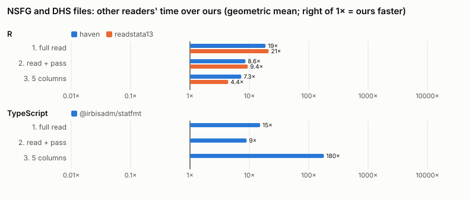

# dta-parser

Read and write Stata `.dta` files from R, Python, Julia, and
TypeScript, with one implementation of the format underneath all four.

- **Reads every release from 104 to 119**, from either byte order, and
  **writes release 118**, which Stata 14 and later, haven, pandas and
  ReadStat read.
- **Keeps Stata's missing values `.a` to `.z`** per value, through
  filtering, sorting and merging, and writes them back. Of the other
  readers, haven keeps them too (as tagged NAs); readstata13, pandas and
  pyreadstat return one `NA`/`NaN` unless asked (`missing.type = TRUE`,
  `convert_missing=True`, `user_missing=True`), and then in a separate or
  slower form; ReadStatTables.jl and statfmt keep only one missing value. One missing
  value loses the reason an answer is missing (`.d` "don't know", `.r`
  "refused"). See [missing values](docs/guide/missing-values.md).
- **Keeps the metadata**: variable labels, value labels (including labels
  on `.a` to `.z`), display formats, storage types, the data label and
  notes, characteristics, the sort order and the timestamp.
- **Reads fixed-width text through a SAS setup file**, such as the
  National Survey of Family Growth from 1973 to 2017-2019, with the
  setup's missing-value recodes kept as `.a`, `.b`, ... on request
  (`read_fixed_width` in R, Python and Julia, `readFixedWidth` in
  TypeScript).
- **Reads and writes Parquet that keeps all of this** (in R, through
  datakit's `read_parquet()` and `save_parquet()`; in Python, datakit's
  `read_parquet` and `save_parquet`, into polars; in Julia, Datakit's
  `read_parquet` and `save_parquet`; in TypeScript, `@jbearak/datakit`'s
  `readParquet()` and `saveParquet()`): labels, formats and
  notes travel in the file's metadata and `.a` to `.z` in its values
  (as NaNs that carry the letter), and the file is plain Parquet that pyarrow, polars, DuckDB, arrow and nanoparquet
  read. A tibble or DataFrame read from a `.dta` file comes back the
  same. See [docs/parquet.md](docs/parquet.md), whose headings are the
  tasks (install, read, columns, rows, metadata, labels, dates, write,
  `.a` to `.z`, other tools' files), or go to each language's Parquet
  section: [R](docs/r.md#parquet-files),
  [Python](docs/python.md#parquet-files),
  [Julia](docs/julia.md#parquet-files) and
  [TypeScript](docs/typescript.md#datakit-parquet-files-fixed-width-files-and-whole-datasets).
- **Reads only what you ask for**: a few columns, a window of rows, or
  the metadata alone, from files of any size, including over 4 GiB.
- **Fast.** The format is parsed by a Rust core (`crates/dta`) that
  each language calls directly; [bench/RESULTS.md](bench/RESULTS.md)
  compares it with haven, readstata13, pandas, pyreadstat,
  ReadStatTables.jl, StatFiles.jl and @irbisadm/statfmt.



*The other readers' time over ours, per language, on the 36 NSFG and 10
DHS files (geometric mean; right of 1× means ours is faster). Details
in [bench/RESULTS.md](bench/RESULTS.md).*

## Packages

| language | package | docs | returns |
|---|---|---|---|
| R | `dtatools` | [docs/r.md](docs/r.md) | a tibble whose numeric columns keep `.a` to `.z` and compare as Stata does |
| R | `dtaparser` | [docs/r.md](docs/r.md#plain-r-types-dtaparser) | a tibble of standard R types (integers, doubles, `Date`; factors on request), every missing value `NA`, `.a` to `.z` as haven's tagged NAs, labelled columns as a class whose labels survive dplyr; `na_tag()`, `var_label()`, `val_labels()` and `val_label()` read them and the labels back, `tagged_na()` and `with_labels()` make them, and `save_dta()` writes them, dates included |
| Python | `dta_parser` | [docs/python.md](docs/python.md) | a pandas DataFrame |
| Python | `datakit` | [docs/python.md](docs/python.md#datakit-parquet-dta-and-fixed-width-files-in-polars) | a polars DataFrame from Parquet, `.dta` or fixed-width text, with labels and `.a` to `.z` in a `Meta` beside it |
| Julia | `DtaParser` | [docs/julia.md](docs/julia.md) | a Tables.jl table; `DataFrame(t)` |
| Julia | `Datakit` | [docs/julia.md](docs/julia.md#datakit-parquet-and-fixed-width-text-into-dataframes) | a DataFrame from Parquet or fixed-width text, labels in its metadata, `.a` to `.z` in `DtaColumn`s |
| TypeScript, JavaScript | `@jbearak/dta-parser` | [docs/typescript.md](docs/typescript.md) | typed arrays per column, or rows |
| TypeScript, JavaScript | `@jbearak/datakit` | [docs/typescript.md](docs/typescript.md#datakit-parquet-files-fixed-width-files-and-whole-datasets) | a `Dataset` of typed-array columns from Parquet, `.dta` or fixed-width text, with labels and `.a` to `.z`; a reader for Parquet like dta-parser's for `.dta` |

In R, `dtatools` is for testing Stata pipelines, where Stata's rules
for missing values matter; `dtaparser` is for analysing data under R's
rules. `datakit` is for data preparation:

- `d[i, name, by = g] := value` makes or changes a column for some rows
  within groups, as `generate`, `replace`, and `bysort` do. Python, Julia,
  and Stata do this in a line; for a data frame, R has no ergonomic way
  to otherwise.
- It reads and writes Stata `.dta` files (`read_dta`, `read_meta`,
  `save_dta`) and reads fixed-width `.dat` files through their SAS
  setup files (`read_fixed_width`).
- Columns keep value labels and the missing values `.a` to `.z`, read
  and set with `var_label`, `val_labels`, `with_labels`, `tagged_na`,
  and `na_tag`, so haven and labelled are not needed.
- `read_parquet` and `save_parquet` read and write Parquet files that
  keep them: an interchange format with readers and writers in R,
  Python, Julia, and TypeScript, so data goes between them with its
  labels and letters.

`library(datakit)` is all a script attaches, after dplyr and tidyr if it
uses them, so that its `:=` is the one R finds. datakit re-exports
dtaparser's functions; dtatools has its own `read_dta`, `save_dta`, and
label functions for dibbles, so a script uses one of the two. Julia
has the same split, without `:=`: DtaParser reads and writes `.dta`, and
Datakit reads Parquet and fixed-width text into DataFrames, saves
Parquet, and re-exports DtaParser's functions, so `using Datakit` is
enough. Python's datakit works in polars rather than pandas: it reads
and saves Parquet, `.dta` and fixed-width text as a polars frame and a
`Meta` of labels and letters, while `dta_parser` stays the pandas
package for `.dta` files. TypeScript's `@jbearak/datakit` reads and
saves Parquet, `.dta` and fixed-width text as a `Dataset` whose columns
keep their letters, and reads Parquet through the same `TableReader`
interface as `@jbearak/dta-parser` reads `.dta`.

None of them is on a package registry (CRAN, PyPI, Julia's General
registry or npm). Install them from this repository:

- **R**: [Install](docs/r.md#install). The project's own R package
  repository has binaries for macOS, Windows and Ubuntu, which need no
  Rust:
  `install.packages("dtatools", repos = c("https://jbearak.github.io/dta-parser", "https://cloud.r-project.org"))`.
- **Python**: [Install](docs/python.md#install), from a checkout:
  `pip install ./dta-parser/python ./dta-parser/python/datakit`.
- **Julia**: [Install](docs/julia.md#install), from a checkout with
  `Pkg.develop`.
- **TypeScript**: [Install](docs/typescript.md#install), built from a
  checkout.

Building from a checkout needs Rust ([rustup.rs](https://rustup.rs))
and a C compiler; each Install section says what else, and what to do
when the build fails.

The [guide](docs/guide/README.md) explains the parts of a `.dta` file
that matter when you use it (releases, storage types, missing values,
value labels, encodings, strLs, dates) and how each language represents
them.

## A first example in each language

Each example writes a small file with a labelled column and a "don't
know" answer, then reads it back.

**R**

```r
library(dtaparser)

smoker <- with_labels(c(1, 0, tagged_na("d")),
                      c(No = 0, Yes = 1, tagged_na(c("Don't know" = "d"))))
save_dta(data.frame(id = 1:3, smoker = smoker), "smokers.dta")

back <- read_dta("smokers.dta")
back$smoker             # 1 [Yes]  0 [No]  NA(d) [Don't know]
val_label(back$smoker)  # "Yes" "No" "Don't know"
```

**Python**

```python
import pandas as pd
import dta_parser as dp
from dta_parser import missing

df = pd.DataFrame({"id": [1, 2, 3], "smoker": pd.Series([1, 0, missing.d], dtype="dta[byte]")})
df.attrs["dta"] = {"columns": {"smoker": {"value_labels": "yesno"}},
                   "value_labels": {"yesno": {0: "No", 1: "Yes", missing.d: "Don't know"}}}
dp.write_dta(df, "smokers.dta")

back = dp.read_dta("smokers.dta")
print(back["smoker"].tolist())                          # [1.0, 0.0, .d]
print(back.attrs["dta"]["value_labels"]["yesno"])       # {0: 'No', 1: 'Yes', .d: "Don't know"}
```

**Julia**

```julia
using DtaParser, DataFrames   # DataFrames brings `metadata`

write_dta("smokers.dta", (id = [1, 2, 3], smoker = DtaColumn(Int8[1, 0, 0], UInt8[0, 0, 5]));
          value_labels = Dict("yesno" => Dict(0 => "No", 1 => "Yes", ".d" => "Don't know")),
          column_value_labels = Dict(:smoker => "yesno"))

back = read_dta("smokers.dta")
stata_code(back.smoker, 3)                                  # 0x05, that is .d
metadata(back, "value_labels")["yesno"][dta_key(".d")]    # "Don't know"
```

**TypeScript**

```ts
import { MISSING, type Missing } from "@jbearak/dta-parser";
import { openDtaFile, writeDtaFile } from "@jbearak/dta-parser/node";

writeDtaFile("smokers.dta", {
  valueLabels: { yesno: new Map<number | Missing, string>([[0, "No"], [1, "Yes"], [MISSING[".d"], "Don't know"]]) },
  variables: [
    { name: "id", type: "long", values: [1, 2, 3] },
    { name: "smoker", type: "byte", valueLabels: "yesno", values: [1, 0, MISSING[".d"]] },
  ],
});

const r = openDtaFile("smokers.dta");
console.log(r.readRows(0, 3, ["smoker"]));             // [ [ 1 ], [ 0 ], [ { missing: '.d' } ] ]
console.log(r.valueLabels("yesno")?.get(MISSING[".d"])); // Don't know
r.close();
```

## What each language supports

The core rows are the same in every language. Where a language differs,
the table says how.

| feature | R | Python | Julia | TypeScript |
|---|---|---|---|---|
| read releases 104 to 119, both byte orders | ✓ | ✓ | ✓ | ✓ |
| select columns; a row range | ✓ | ✓ | ✓ | ✓ |
| storage types, variable labels, display formats, data label, notes | ✓ | ✓ | ✓ | ✓ |
| timestamp, characteristics, sort order | ✓ | ✓ | ✓ | ✓ |
| value labels, including labels on `.a` to `.z` | ✓ | ✓ | ✓ | ✓ |
| `.` and `.a` to `.z` kept per value and written back | ✓ `dta_num` | ✓ `DtaArray` | ✓ `DtaColumn` (not through DataFrames' `combine`/`vcat`) | ✓ codes |
| binary strLs | an error | read and write (`bytes`) | read and write (`Vector{UInt8}`) | read and write (`Uint8Array`) |
| text encoding option for files before release 118 | ✓ | ✓ | ✓ | ✓ |
| fixed-width text through a SAS setup file | datakit's `read_fixed_width` | datakit's `read_fixed_width` (polars) | Datakit's `read_fixed_width` | datakit's `readFixedWidth` |
| Parquet files that keep labels and `.a` to `.z` | datakit's `read_parquet`, `save_parquet` | datakit's `read_parquet`, `save_parquet` (polars) | Datakit's `read_parquet`, `save_parquet` | datakit's `readParquet`, `saveParquet`; `openParquetFile`, the same reader interface as `.dta` |
| `%td`, `%tc` as dates | dtatools: numbers with their format; dtaparser: `Date`, `POSIXct` | `datetime64` (opt out) | `Date`, `DateTime` (opt out) | numbers; `formatValue` |
| write release 118 | ✓ | ✓ | ✓ | ✓ |
| a key that sorts and compares as Stata does | built into `dta_num` | `dta_key`, `dta_keys` | `dta_key` | `dtaKey`, `dtaKeys` |
| Stata comparisons, arithmetic and logic on columns; `tab`, group ids, sets | ✓ | | | |

**Round trips.** In every language, reading a file and writing what was
read gives the same values, missing codes, numeric storage types,
labels, value labels, display formats and notes, within the table above.
String columns come back as narrow as their values allow (and in R and
TypeScript a short strL as a fixed-width string). Text from a file older
than release 118 comes back as UTF-8.

## Repository

| path | what |
|---|---|
| `crates/dta` | the format, in Rust: reader and release 118 writer |
| `crates/dta-ffi` | the WebAssembly interface (for TypeScript) and C interface (for Julia) |
| `r/dtaparser` | the R package that reads into standard R types, and the R bridge to the core |
| `r/datakit` | the R package for data preparation: `:=`, `read_fixed_width`, and Parquet's `read_parquet` and `save_parquet` |
| `r/dtatools` | the R package with Stata's rules, built on dtaparser and datakit |
| `python` | the Python package `dta_parser` |
| `python/datakit` | the Python package for data preparation in polars: Parquet, `.dta`, and fixed-width text with labels and `.a` to `.z` |
| `julia/DtaParser` | the Julia package |
| `js` | the npm package |
| `compat` | test files from haven, pandas and ReadStat, and what those readers make of them |
| `bench` | benchmarks against the other readers |
| `docs` | this documentation, [decisions](docs/adr/) and [plans](docs/plans/) |

To build, test or change anything, see [CONTRIBUTING.md](CONTRIBUTING.md).

## Acknowledgements

dta-parser learns from, tests against and compares itself with these
open-source projects:

- **What we know of the format** comes mainly from the code and
  documentation of [ReadStat](https://github.com/WizardMac/ReadStat)
  (Evan Miller and contributors, MIT) and of pandas' Stata reader and
  writer, [`pandas/io/stata.py`](https://github.com/pandas-dev/pandas/blob/main/pandas/io/stata.py)
  (the pandas development team, BSD-3-Clause). The Rust core in
  `crates/dta` is our own implementation and contains no code from
  either.
- **Tagged missing values in R**: dtatools and dtaparser store `.a` to
  `.z` inside `NA` with the same bits as `tagged_na()` in
  [haven](https://github.com/tidyverse/haven) (Hadley Wickham, Evan
  Miller, Danny Smith), so the values pass between the two packages
  unchanged ([missing values](docs/guide/missing-values.md)).
- **Reference readers**: the tests check what we read against haven,
  [readstata13](https://github.com/sjewo/readstata13) (Jan Marvin
  Garbuszus, Sebastian Jeworutzki), pandas and
  [pyreadstat](https://github.com/Roche/pyreadstat) (Otto Fajardo), and
  the Julia tests against
  [ReadStatTables.jl](https://github.com/junyuan-chen/ReadStatTables.jl)
  (Junyuan Chen). See [compat/README.md](compat/README.md) and
  [ADR 0005](docs/adr/0005-oracles.md).
- **Test fixtures**: ReadStat's writer makes the files for releases
  104, 105, 108, 110 and 111 (`compat/make_legacy_fixtures.sh`),
  haven and pandas write the rest, and the big-endian files for
  releases 104 to 113 come from pandas' test suite ([compat/fixtures/README.md](compat/fixtures/README.md)).
- **Benchmarks and documentation**: the
  [benchmark plan](docs/plans/0005-four-languages.md) measures our speed
  against haven, readstata13, pandas, pyreadstat, ReadStatTables.jl,
  [StatFiles.jl](https://github.com/queryverse/StatFiles.jl) (David
  Anthoff) and [@irbisadm/statfmt](https://github.com/irbisadm/statfmt)
  (Igor Sheko), and [docs/judging](docs/judging/rubric.md) compared our
  documentation with that of each of them except StatFiles.jl.
- **Parquet**: the reader and writer are our own code, written after
  studying the Parquet format specification and the open-source
  libraries in [docs/acknowledgements.md](docs/acknowledgements.md),
  which lists each with its license and what we learned from it, and
  the codec crates we use.

## License

GPL-3.0 (see [LICENSE](LICENSE)). Some test fixtures come from pandas'
test suite, under its BSD-3-Clause license
([compat/fixtures/LICENSE-pandas](compat/fixtures/LICENSE-pandas)).
