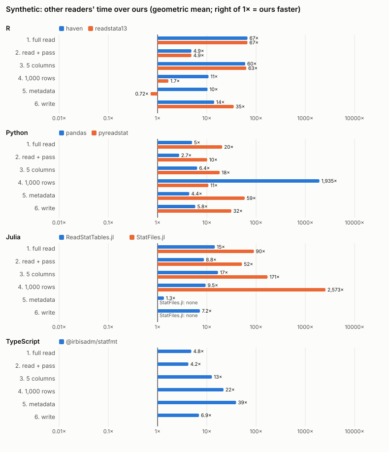
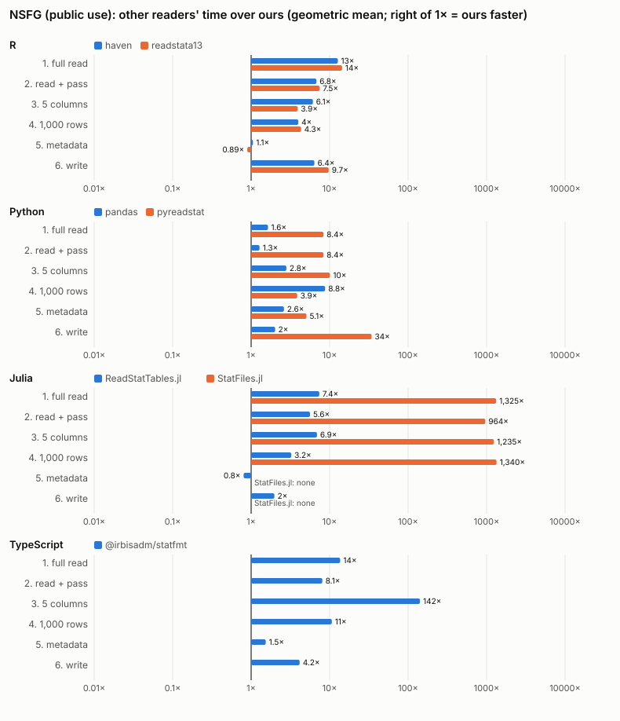
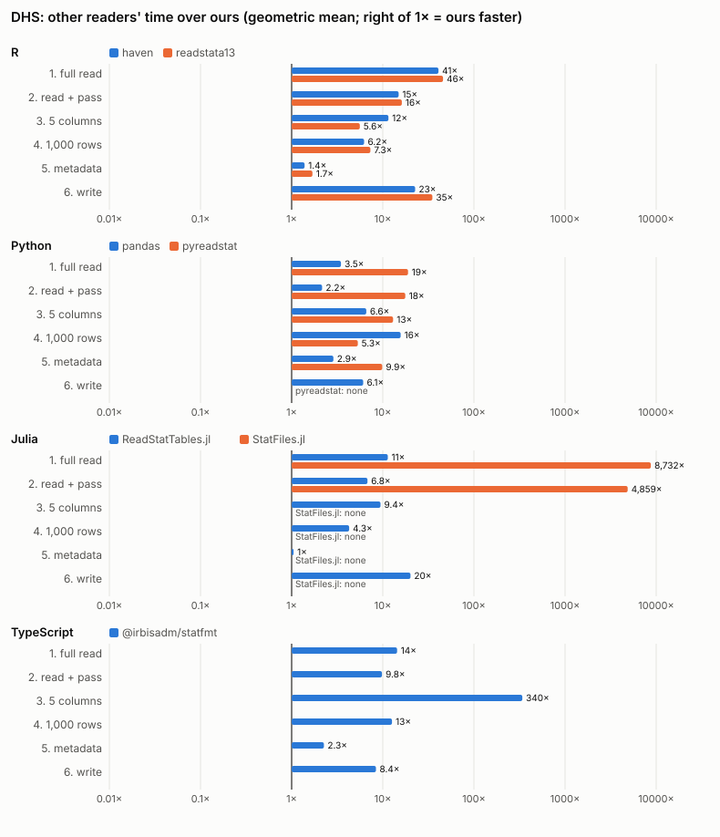

# Benchmark results

Generated by `bench/run.py`; the findings section is written by hand from these numbers.

## Findings

On the 36 public-use NSFG files and the 10 DHS files, ours is faster than
every other reader in its language at reading whole files, at the pass
over every value, at five columns and at a 1,000-row window, taking the
geometric mean over the files (the exceptions on single files are under
"Targets missed"). The other readers' time over ours:

| language | full read (NSFG, DHS) | read + pass (NSFG, DHS) |
|---|---|---|
| R | haven 15×, 41×; readstata13 17×, 46× | haven 7.4×, 15×; readstata13 8.1×, 16× |
| Python | pandas 2.2×, 3.5×; pyreadstat 11×, 19× | pandas 1.5×, 2.2×; pyreadstat 9.7×, 18× |
| Julia | ReadStatTables 9.4×, 11×; StatFiles about 1,700×, 8,700× | ReadStatTables 6.6×, 6.8× |
| TypeScript | statfmt 15×, 14× | statfmt 8.8×, 9.8× |

These are after plan 0007 (fixes 9 to 13 below), which made ours faster
in every language; the other readers were not re-run.

The margin is narrowest in Python, where pandas' reader is NumPy code too,
and in R's pass over every value, where dtatools makes its packed
strings into R strings (ADR 0010). Metadata alone is where the others
come closest: readstata13 (which here reads one row) and ReadStatTables
are as fast or faster on the smaller files, by fractions of a
millisecond.

### Fixed because of these runs

Each fix is its own commit, with a test where the behaviour can be
tested (1 to 5). Ours was then measured again with `--readers ours`;
the other readers' results were not re-run.

1. **Python, `attrs`** (`python/dta_parser/_read.py`). pandas deep-copies
   `attrs` into every column and frame it derives, and ours kept the
   file's metadata there, so each `df[c]` on a 3,000-variable file cost
   about 5 ms. `attrs["dta"]` is now shared by derived frames (docs/python.md
   says how to give one its own). 2017_2019_Male: the pass over every
   value 14.06 s → 0.14 s (pandas 0.24 s), `write_dta` 13.74 s → 0.20 s
   (pandas 0.51 s).
2. **Julia, first calls** (`julia/DtaParser/src/precompile.jl`,
   `read.jl`, `json.jl`). A session's first call compiled the read
   path: `read_meta` took 0.12 s on long.dta (ReadStatTables 0.006 s), a
   1,000-row window 0.50 s (0.18 s). A precompile workload over every
   storage type, and metadata built in typed loops: 0.0015 s and 0.022 s.
   `read_meta` on 1973_FemResp, warm: 2.6 ms → 1.4 ms.
3. **TypeScript, writing** (`js/src/index.ts`). Writing what
   `readColumns` returned meant an array of numbers and `Missing` values
   per column, and a `Uint8Array` per string. A variable may now give its
   `Float64Array` and missing codes, and strings are encoded into one
   buffer. long.dta: 10.2 s and 9.3 GB → 3.5 s and 3.4 GB (statfmt
   18.8 s); 2002_FemPreg: 289 MB → 195 MB (statfmt 187 MB).
4. **Core, chunk size** (`crates/dta/src/reader.rs`). Chunks were 8 MiB
   of rows, but a byte decodes to 9 bytes, so files of byte variables
   held 72 MiB decoded per chunk. Chunks are now 8 MiB decoded. With the
   next fix, peak memory of a full read of 2015_2017_Male: Python
   390 MB → 198 MB (pandas 249 MB), R 365 MB → 255 MB (readstata13
   229 MB), TypeScript 573 MB → 418 MB with fix 7 (statfmt 325 MB).
5. **Python, string cache** (`python/src/lib.rs`). Every column got a
   32 KiB cache of recent strings, numeric or not: 100 MB on that file.
   It is now made on a column's first string.
6. **Core, column room** (`crates/dta/src/reader.rs`). Decoded columns
   grew by doubling; they now reserve a chunk's rows. Python's native
   read: 1976_Preg 7.0 → 4.8 ms, 2015_2017_Male 42.5 → 33.8 ms.
7. **wasm, read buffers** (`crates/dta-ffi/src/wasm.rs`). Appending
   chunks regrew the columns in module memory, which never shrinks; a
   read now reserves its rows.
8. **The harness, not the package**: haven loads tibble and vctrs with
   itself, dtatools on its first read, so 0.08 s fell inside dtatools'
   timed tasks only. Both now load them before the clock.

9. **R, writing packed strings** (plan 0007, `r/dtaparser/src`). The
   writer made every R string of a column `read_dta` had packed (20M on
   long.dta) before writing it; it now writes their bytes. R's write of
   the synthetic files: 9.3× faster (geometric mean), 27% less peak
   memory; long.dta 6.17 s → 0.80 s.
10. **Core, writing by block** (plan 0007, `crates/dta/src/writer.rs`).
    Numbers are filled 1,024 rows per call and rows built column by
    column in 256 KiB slabs, not a dynamic call per cell. The core's
    write of wide.dta, one thread: 5.40 s → 2.02 s. Bytes unchanged
    (`crates/dta/tests/identity.rs`).
11. **Core, reading** (plan 0007, `crates/dta/src/reader.rs`). 2 MiB
    chunks, and numbers decoded into sized columns: the core's read of
    wide.dta 1.00 s → 0.71 s.
12. **Threads** (plan 0007). Large reads and writes (16 MiB and up)
    use up to three threads (half the hardware threads on x86): workers
    read and decode chunks and, in R and Python, fill numeric columns;
    chunks reach the caller in row order. At three threads every read
    and write measured used at most 1.15× the CPU time of one thread
    (`bench/threads/`); e.g. R reads wide.dta 1.19 s → 0.49 s. wasm
    stays on one thread. Geometric-mean speed-ups of a full read: R
    2.2×, 1.2×, 1.9× (synthetic, NSFG, DHS), Python 1.9×, 1.35×, 2.0×,
    Julia 1.8×, 1.3×, 1.5×.
13. **Python, code arrays** (plan 0007). Writing every missing-value
    code committed memory for numpy arrays of zeros it had not touched
    (wide.dta 4.9 → 5.5 GB); only missing values' codes are written.

On GitHub's x86 runners (2 cores, 4 hardware threads, so two threads)
the CI's thread report shows a full read 1.9× faster at 1.10× the CPU,
but a five-column read 1.4× faster at 1.5× the CPU (0.05 s of work,
mostly copying rows out of the page cache) and a write 1.2× faster at
1.2× (bound by the runner's disk). Those cases are reported, not gated.

### Targets missed, and why

- **Julia metadata on small files** (25 files, by 0.01 to 0.1 ms). The
  metadata crosses the C ABI as JSON (the plan's design) and is parsed
  in Julia; ReadStatTables fills its structures directly. Two
  optimisation attempts (fix 2) narrowed it; the rest is that JSON.
- **R metadata and windows on small files** (by 0.02 to 0.2 ms).
  dtatools builds a tibble with per-column attributes; readstata13's
  "metadata" here is a one-row read without them.
- **Python, read + pass on 1976_Preg** (by 8%; four pregnancy files
  before plan 0007). Ours gives byte and int columns with `.` as
  float32 (the plan's representation); the pass sums in float64, so
  each converts, where pandas' columns are already float64.
- **R memory** on the pass over every value (7 files) and one full read:
  dtatools keeps the packed text while R makes its strings (ADR 0010),
  and stores every number as a double (ADR 0003) where readstata13 keeps
  R integers.
- **TypeScript memory** reading one 3,000-variable NSFG file
  (2013_2015_Male, 1.6×) and writing three files: ours holds a
  `Float64Array` and a byte of missing code per value (9 bytes), statfmt
  small integers in plain arrays. Writing copies every column into
  module memory before streaming the file, so writing costs more memory
  than reading, and **wide.dta (4.8 GB) cannot be written** from
  TypeScript: wasm32 memory stops at 4 GiB. Writing row blocks as they
  come would lift that; not done here.
- **Julia, writing groups.dta**: 1.5 GB against ReadStatTables' 1.0 GB;
  the C ABI takes every string column as one byte buffer with offsets,
  a copy of 15M strings.

### What the correctness checks found

- **Values agree everywhere**: every full read, five-column read, window
  and checksum of every reader equals ours, on every file where both
  ran (missing codes too, where haven keeps `.a`–`.z`).
- **Labels with trailing spaces**: haven, pyreadstat, ReadStatTables and
  statfmt (all ReadStat-based) drop trailing spaces from variable and
  value labels; ours, readstata13 and pandas keep the file's text. This
  is every metadata "difference" on NSFG and most on DHS.
- **Windows-1252 text before release 118**: pandas decodes it as
  Latin-1, so a curly apostrophe (byte 0x92) becomes a control
  character in one DHS label per file pair; ours, pyreadstat and
  readstata13 decode it as Windows-1252.
- **Writers**: ours writes back values and metadata that the
  open-source readers read as they read the source, in all four
  languages, except where that reader misreads the source (the pandas
  case above). readstata13's writer drops the data label and display
  formats, pandas' and pyreadstat's change storage types and formats,
  ReadStatTables' changes some labels and value labels on DHS files (not
  investigated further), and pyreadstat cannot write back 30 of the 36
  NSFG frames it read (all-missing numeric columns arrive as objects).
- **Readers that could not finish**: StatFiles takes 5–15 minutes per
  DHS women's file and over a minute on most NSFG files, so tasks 3
  and 4 were not repeated there; it has no metadata read or writer.
  statfmt's write of wide.dta failed in the harness, not in statfmt:
  it wrote the 4.8 GB result with one `fs.writeFileSync`, which Node
  limits to 2 GiB. The harness now writes it in pieces; the measurement
  was not repeated, since the other readers' results are not re-run.

The earlier R-only measurements (writing from R, survey-shaped string
columns, grouping) are in [results/r-only.md](results/r-only.md).

## Method

Machine: Apple M4 Max, 128 GB, macOS 26.7.1. R 4.6.1, Python 3.14.7, Julia 1.13.3, Node v26.12.1. Ours are this repository's packages as of the commit that adds these results.

| language | reader | version | options |
|---|---|---|---|
| R | dtatools | 1.1.0 | `read_dta()`; strings come back packed, so task 2 pays for making them |
| R | haven | 2.5.5 | `read_dta()`; converts `%td`/`%tc` (no option not to); converted back for checks |
| R | readstata13 | 0.11.0 | `read.dta13(convert.factors = FALSE, convert.dates = FALSE)`; task 5 reads one row (no metadata-only read) |
| Python | dta_parser | 0.1.0 | `read_dta(dates=False)` |
| Python | pandas | 3.1.0 | `read_stata(convert_dates=False, convert_categoricals=False)`; task 4 reads up to the window with its iterator (no row offset) |
| Python | pyreadstat | 1.3.7 | `read_dta(disable_datetime_conversion=True)`; writes with `version=14` (release 118) |
| Julia | DtaParser.jl | 0.1.0 | `read_dta()` (dates converted, as ReadStatTables does) |
| Julia | ReadStatTables.jl | 0.4.0 | `readstat()`, one thread (`julia` default) |
| Julia | StatFiles.jl | 1.0.0 | `DataFrame(load(path))`; no selection, metadata read or writer |
| TypeScript | @jbearak/dta-parser | 1.0.0 | `openDtaFile().readColumns()`; task 6 gives `writeDtaFile` the columns as read |
| TypeScript | @irbisadm/statfmt | 0.1.1 | `readDta(bytes)` on the whole file in memory; no column selection; task 5 reads one row |

Each file is read once first (page cache warm). Files over 100 MB: a fresh process per run under /usr/bin/time -l, median of five (three over 1 GB). Smaller files: one process per task times a warm-up call, then up to 20 calls (stopping after 60 s once three ran; a warm-up over 60 s is the only run); peak RSS from one more fresh process with one call (a warm-up over 60 s is that run). Every process has 20 minutes. A reader that times out on a file is not run on that family's larger files. StatFiles, which can only slice a full read, is not timed on tasks 3 and 4 where its full read took over 60 s.

Times are the task alone, from inside the process after its packages loaded (task 6: the write alone, after an untimed read). Peak RSS is the whole process's, from `/usr/bin/time -l`. Node runs with `--max-old-space-size=32768` so that its default heap limit is not what fails. Each task-2 pass is the same loop in every reader of a language (sum of numbers as float64, missing count, string length in characters; JavaScript counts UTF-16 units).

Correctness, outside the timing: each reader's result is hashed per column (numbers as float64 with missing values as a mask, missing codes where the reader keeps `.a`–`.z`, strings as UTF-8), and ours is compared with each open-source reader in its language, on everything both expose; metadata (names, storage types, formats, variable labels, value labels, data label) likewise. Each writer's file is re-read by the language's open-source reader (haven, pandas, ReadStatTables, statfmt) and compared with that reader's read of the source. Task-2 sums agree within 1e-9 × Σ|x|; counts and lengths exactly.

## Targets

Ours fastest within its language at task 2 on every NSFG and DHS file and at tasks 3–5 on every file (5% tie band), with peak RSS within 1.5× of the lowest.

1988 checks met, 68 missed.

| language | task | kind | files missed (ours vs best other) |
|---|---|---|---|
| Julia | 5. metadata | speed | 2002_HHvars (0.00011 s vs 0.000102 s); 2022_2023_FemPreg (0.000217 s vs 0.00014 s); 2011_2019_FemaleWgt (8e-05 s vs 7.61e-05 s); 2017_2019_FemPreg (0.000682 s vs 0.000625 s); 1976_Preg (0.000286 s vs 0.00026 s); 2015_2017_FemPreg (0.000922 s vs 0.00082 s); and 19 more |
| Julia | 6. write | memory | groups.dta (1,551 MB vs 1,027 MB) |
| Python | 2. read + pass | speed | 1976_Preg (0.01 s vs 0.00925 s) |
| R | 1. full read | memory | Myanmar 2016 bh (344 MB vs 217 MB) |
| R | 2. read + pass | memory | 2015_2017_FemResp (373 MB vs 247 MB); 2011_2013_FemResp (375 MB vs 248 MB); 2006_2010_Male (523 MB vs 346 MB); 2006_2010_FemResp (837 MB vs 544 MB); Myanmar 2016 bh (417 MB vs 267 MB); Tajikistan 2017 wm (964 MB vs 548 MB); and 1 more |
| R | 4. 1,000 rows | speed | groups.dta (0.00135 s vs 0.00125 s); 1976_PSU (0.000268 s vs 0.000249 s); 2002_curr_ins (0.000276 s vs 0.000244 s); 2002_hhpartypnew (0.000271 s vs 0.000229 s) |
| R | 5. metadata | speed | groups.dta (0.0013 s vs 0.000875 s); long_114.dta (0.00136 s vs 0.00125 s); long.dta (0.00133 s vs 0.000892 s); long_119.dta (0.00141 s vs 0.000894 s); wide.dta (0.0022 s vs 0.00111 s); 1976_PSU (0.000265 s vs 9.7e-05 s); and 18 more |
| TypeScript | 1. full read | memory | 2013_2015_Male (411 MB vs 261 MB) |
| TypeScript | 2. read + pass | memory | 2013_2015_Male (415 MB vs 262 MB) |
| TypeScript | 6. write | memory | 2013_2015_Male (500 MB vs 313 MB); 2006_2010_Male (830 MB vs 488 MB) |
| TypeScript | 6. write | speed | wide.dta (ours failed: error) |

## Synthetic

| file | release | MB | rows | variables |
|---|---|---|---|---|
| groups.dta | 118 | 270 | 15,000,000 | 2 |
| long_114.dta | 114 | 740 | 10,000,000 | 12 |
| long_117.dta | 117 | 740 | 10,000,000 | 12 |
| long.dta | 118 | 740 | 10,000,000 | 12 |
| long_119.dta | 119 | 740 | 10,000,000 | 12 |
| wide.dta | 118 | 4,800 | 1,500,000 | 400 |

Time: for ours, the geometric mean of its seconds over the files; for the others, the geometric mean of their time over ours (above 1× means ours is faster).

| language | reader | 1. full read | 2. read + pass | 3. 5 columns | 4. 1,000 rows | 5. metadata | 6. write |
|---|---|---|---|---|---|---|---|
| R | dtatools | 0.242 s | 3.6 s | 0.127 s | 0.00163 s | 0.00146 s | 0.461 s |
| R | haven | 67× | 4.9× | 60× | 11× | 10× | 14× |
| R | readstata13 | 67× | 4.9× | 63× | 1.7× | 0.72× | 35× |
| Python | dta_parser | 0.43 s | 0.962 s | 0.241 s | 0.000554 s | 6.92e-05 s | 0.846 s |
| Python | pandas | 5× | 2.7× | 6.4× | 1.9e+03× | 4.4× | 5.8× |
| Python | pyreadstat | 20× | 10× | 18× | 11× | 59× | 32× |
| Julia | DtaParser.jl | 0.417 s | 0.74 s | 0.219 s | 0.0144 s | 0.00474 s | 0.501 s |
| Julia | ReadStatTables.jl | 15× | 8.8× | 17× | 9.5× | 1.3× | 7.2× |
| Julia | StatFiles.jl | 90× | 52× | 1.7e+02× | 2.6e+03× | – (6 no API) | – (6 no API) |
| TypeScript | @jbearak/dta-parser | 2.28 s | 2.71 s | 0.972 s | 0.00264 s | 0.0014 s | 2.22 s (1 failed) |
| TypeScript | @irbisadm/statfmt | 4.8× | 4.2× | 13× | 22× | 39× | 6.9× (1 failed) |

Peak RSS, the same way:

| language | reader | 1. full read | 2. read + pass | 3. 5 columns | 4. 1,000 rows | 5. metadata | 6. write |
|---|---|---|---|---|---|---|---|
| R | dtatools | 1,322 MB | 2,559 MB | 525 MB | 99 MB | 97 MB | 1,341 MB |
| R | haven | 1.4× | 1.2× | 1.6× | 1.1× | 1.1× | 1.4× |
| R | readstata13 | 1.5× | 1.1× | 1.7× | 0.96× | 0.97× | 1.8× |
| Python | dta_parser | 1,668 MB | 1,730 MB | 726 MB | 82 MB | 81 MB | 1,774 MB |
| Python | pandas | 2.6× | 2.5× | 5.4× | 27× | 0.99× | 3.8× |
| Python | pyreadstat | 2× | 1.9× | 1.5× | 1.1× | 1.1× | 1.9× |
| Julia | DtaParser.jl | 1,932 MB | 1,955 MB | 830 MB | 301 MB | 300 MB | 2,271 MB |
| Julia | ReadStatTables.jl | 0.77× | 0.77× | 0.88× | 1.3× | 1.3× | 0.8× |
| Julia | StatFiles.jl | 1.9× | 1.9× | 4.9× | 13× | – | – |
| TypeScript | @jbearak/dta-parser | 2,115 MB | 2,126 MB | 832 MB | 56 MB | 52 MB | 3,043 MB |
| TypeScript | @irbisadm/statfmt | 2.6× | 2.6× | 8× | 17× | 18× | 3.1× |

Per file: [results/synthetic.md](results/synthetic.md).

## NSFG (public use)

| file | release | MB | rows | variables |
|---|---|---|---|---|
| 1976_PSU | 118 | 0 | 8,611 | 3 |
| 2002_curr_ins | 118 | 0 | 12,571 | 3 |
| 2002_hhpartypnew | 118 | 0 | 12,571 | 3 |
| 2002_HHvars | 118 | 0 | 12,571 | 10 |
| 2011_2019_MaleWgt | 118 | 1 | 19,067 | 7 |
| 2022_2023_FemPreg | 118 | 1 | 8,247 | 111 |
| 2011_2019_FemaleWgt | 118 | 1 | 22,995 | 7 |
| 2017_2019_FemPreg | 118 | 2 | 10,215 | 171 |
| 1976_Preg | 118 | 2 | 23,042 | 80 |
| 2015_2017_FemPreg | 118 | 3 | 9,553 | 248 |
| 1982_Preg | 118 | 3 | 13,768 | 174 |
| 2013_2015_FemPreg | 118 | 3 | 9,358 | 278 |
| 2011_2013_FemPreg | 118 | 3 | 9,543 | 278 |
| 2002_FemPreg | 118 | 4 | 13,593 | 243 |
| 1973_FemResp | 118 | 6 | 9,797 | 450 |
| 1976_FemResp | 118 | 6 | 8,611 | 468 |
| 1995_Preg | 118 | 6 | 21,332 | 245 |
| 2022_2023_MaleResp | 118 | 6 | 4,371 | 1,157 |
| 1982_FemResp | 118 | 8 | 7,969 | 741 |
| 2006_2010_FemPreg | 118 | 8 | 20,492 | 287 |
| 1988_Preg | 118 | 11 | 15,759 | 284 |
| 2002_Male | 118 | 13 | 4,928 | 1,993 |
| 2022_2023_FemResp | 118 | 13 | 5,586 | 1,912 |
| 2015_2017_Male | 118 | 18 | 4,540 | 2,945 |
| 2013_2015_Male | 118 | 18 | 4,506 | 2,940 |
| 1988_FemResp | 118 | 19 | 8,450 | 1,437 |
| 2011_2013_Male | 118 | 19 | 4,815 | 3,059 |
| 2017_2019_Male | 118 | 20 | 5,206 | 3,009 |
| 2017_2019_FemResp | 118 | 20 | 6,141 | 2,609 |
| 2015_2017_FemResp | 118 | 22 | 5,554 | 3,024 |
| 2011_2013_FemResp | 118 | 23 | 5,601 | 3,094 |
| 2013_2015_FemResp | 118 | 24 | 5,699 | 3,207 |
| 2002_FemResp | 118 | 29 | 7,643 | 3,087 |
| 2006_2010_Male | 118 | 37 | 10,403 | 2,801 |
| 2006_2010_FemResp | 118 | 56 | 12,279 | 3,741 |
| 1995_FemResp | 118 | 79 | 10,847 | 5,754 |

Time: for ours, the geometric mean of its seconds over the files; for the others, the geometric mean of their time over ours (above 1× means ours is faster).

| language | reader | 1. full read | 2. read + pass | 3. 5 columns | 4. 1,000 rows | 5. metadata | 6. write |
|---|---|---|---|---|---|---|---|
| R | dtatools | 0.0106 s | 0.0239 s | 0.0031 s | 0.0049 s | 0.00405 s | 0.0178 s |
| R | haven | 15× | 7.4× | 6.4× | 4.2× | 1.1× | 11× |
| R | readstata13 | 17× | 8.1× | 4.1× | 4.5× | 0.93× | 17× |
| Python | dta_parser | 0.0111 s | 0.0228 s | 0.00165 s | 0.00419 s | 0.000761 s | 0.0185 s |
| Python | pandas | 2.2× | 1.5× | 3× | 9.5× | 2.6× | 3.5× |
| Python | pyreadstat | 11× | 9.7× | 11× | 4.2× | 5.1× | 50× (30 failed) |
| Julia | DtaParser.jl | 0.00804 s | 0.0121 s | 0.00233 s | 0.00277 s | 0.00166 s | 0.00983 s |
| Julia | ReadStatTables.jl | 9.4× | 6.6× | 7.2× | 3.5× | 0.84× | 4.9× |
| Julia | StatFiles.jl | 1.7e+03× | 1.1e+03× | 1.3e+03× (18 not run) | 1.5e+03× (18 not run) | – (36 no API) | – (36 no API) |
| TypeScript | @jbearak/dta-parser | 0.0126 s | 0.023 s | 0.00132 s | 0.0024 s | 0.00153 s | 0.018 s |
| TypeScript | @irbisadm/statfmt | 15× | 8.8× | 1.5e+02× | 12× | 1.6× | 9.2× |

Peak RSS, the same way:

| language | reader | 1. full read | 2. read + pass | 3. 5 columns | 4. 1,000 rows | 5. metadata | 6. write |
|---|---|---|---|---|---|---|---|
| R | dtatools | 174 MB | 215 MB | 102 MB | 112 MB | 100 MB | 194 MB |
| R | haven | 1.1× | 1.1× | 1.2× | 1.2× | 1.2× | 1× |
| R | readstata13 | 0.86× | 0.85× | 1.1× | 1.1× | 1.2× | 1× |
| Python | dta_parser | 138 MB | 139 MB | 87 MB | 96 MB | 86 MB | 146 MB |
| Python | pandas | 1.1× | 1.1× | 1.2× | 1.4× | 0.95× | 2.3× |
| Python | pyreadstat | 1.6× | 1.6× | 1.1× | 1.3× | 1.1× | 1.1× |
| Julia | DtaParser.jl | 333 MB | 337 MB | 306 MB | 305 MB | 302 MB | 346 MB |
| Julia | ReadStatTables.jl | 1.3× | 1.3× | 1.3× | 1.3× | 1.3× | 1.2× |
| Julia | StatFiles.jl | 2.9× | 2.9× | 1.9× | 1.9× | – | – |
| TypeScript | @jbearak/dta-parser | 202 MB | 203 MB | 61 MB | 89 MB | 62 MB | 229 MB |
| TypeScript | @irbisadm/statfmt | 0.99× | 0.98× | 3.2× | 1.2× | 1.3× | 0.97× |

Per file: [results/nsfg.md](results/nsfg.md).

## DHS

| file | region | release | MB | rows | variables |
|---|---|---|---|---|---|
| Dominican Republic 2013 bh | Latin America and the Caribbean | 113 | 22 | 18,167 | 1,078 |
| Turkey 2013 bh | North Africa, West Asia and Europe | 113 | 23 | 17,871 | 1,173 |
| Senegal 2019 bh | Sub-Saharan Africa | 113 | 29 | 21,562 | 1,191 |
| Tajikistan 2017 bh | Central Asia | 113 | 29 | 21,985 | 1,146 |
| Myanmar 2016 bh | South and Southeast Asia | 113 | 31 | 22,989 | 1,184 |
| Dominican Republic 2013 wm | Latin America and the Caribbean | 113 | 40 | 9,372 | 3,854 |
| Senegal 2019 wm | Sub-Saharan Africa | 113 | 49 | 8,649 | 4,997 |
| Turkey 2013 wm | North Africa, West Asia and Europe | 113 | 53 | 9,746 | 4,668 |
| Tajikistan 2017 wm | Central Asia | 113 | 64 | 10,718 | 5,160 |
| Myanmar 2016 wm | South and Southeast Asia | 113 | 72 | 12,885 | 4,993 |

Time: for ours, the geometric mean of its seconds over the files; for the others, the geometric mean of their time over ours (above 1× means ours is faster).

| language | reader | 1. full read | 2. read + pass | 3. 5 columns | 4. 1,000 rows | 5. metadata | 6. write |
|---|---|---|---|---|---|---|---|
| R | dtatools | 0.0522 s | 0.154 s | 0.00945 s | 0.0216 s | 0.0174 s | 0.107 s |
| R | haven | 41× | 15× | 12× | 6.2× | 1.4× | 23× |
| R | readstata13 | 46× | 16× | 5.6× | 7.3× | 1.7× | 35× |
| Python | dta_parser | 0.0642 s | 0.132 s | 0.00576 s | 0.0215 s | 0.00321 s | 0.0952 s |
| Python | pandas | 3.5× | 2.2× | 6.6× | 16× | 2.9× | 6.1× |
| Python | pyreadstat | 19× | 18× | 13× | 5.3× | 9.9× | – (10 failed) |
| Julia | DtaParser.jl | 0.0541 s | 0.0974 s | 0.00764 s | 0.0118 s | 0.00548 s | 0.0396 s |
| Julia | ReadStatTables.jl | 11× | 6.8× | 9.4× | 4.3× | 1× | 20× |
| Julia | StatFiles.jl | 8.7e+03× | 4.9e+03× | – (10 not run) | – (10 not run) | – (10 no API) | – (10 no API) |
| TypeScript | @jbearak/dta-parser | 0.127 s | 0.193 s | 0.00539 s | 0.0109 s | 0.00461 s | 0.165 s |
| TypeScript | @irbisadm/statfmt | 14× | 9.8× | 3.4e+02× | 13× | 2.3× | 8.4× |

Peak RSS, the same way:

| language | reader | 1. full read | 2. read + pass | 3. 5 columns | 4. 1,000 rows | 5. metadata | 6. write |
|---|---|---|---|---|---|---|---|
| R | dtatools | 412 MB | 552 MB | 105 MB | 127 MB | 102 MB | 484 MB |
| R | haven | 1× | 1× | 1.3× | 1.2× | 1.3× | 0.9× |
| R | readstata13 | 0.78× | 0.69× | 1.5× | 1.3× | 1.6× | 0.88× |
| Python | dta_parser | 339 MB | 340 MB | 89 MB | 110 MB | 87 MB | 361 MB |
| Python | pandas | 1.3× | 1.3× | 1.8× | 2.7× | 0.95× | 4.9× |
| Python | pyreadstat | 2.1× | 2× | 1.1× | 1.5× | 1.2× | – |
| Julia | DtaParser.jl | 417 MB | 419 MB | 307 MB | 310 MB | 303 MB | 441 MB |
| Julia | ReadStatTables.jl | 1.2× | 1.2× | 1.3× | 1.3× | 1.3× | 1.1× |
| Julia | StatFiles.jl | 4.6× | 4.7× | – | – | – | – |
| TypeScript | @jbearak/dta-parser | 603 MB | 603 MB | 68 MB | 136 MB | 66 MB | 858 MB |
| TypeScript | @irbisadm/statfmt | 0.87× | 0.88× | 7.8× | 1.3× | 1.7× | 0.73× |

Per file: [results/dhs.md](results/dhs.md).

## Correctness

### Synthetic

Ours against each reader (write: each writer's file re-read by the open-source reader). Counts are files.

| language | reader | what | agree | differ | not compared |
|---|---|---|---|---|---|
| R | haven | full | 6 | 0 | 0 |
| R | haven | five | 6 | 0 | 0 |
| R | haven | window | 6 | 0 | 0 |
| R | haven | meta | 6 | 0 | 0 |
| R | haven | checksum | 6 | 0 | 0 |
| R | readstata13 | full | 6 | 0 | 0 |
| R | readstata13 | five | 6 | 0 | 0 |
| R | readstata13 | window | 6 | 0 | 0 |
| R | readstata13 | meta | 6 | 0 | 0 |
| R | readstata13 | checksum | 6 | 0 | 0 |
| R | dtatools | write | 6 | 0 | 0 |
| R | haven | write | 6 | 0 | 0 |
| R | readstata13 | write | 0 | 6 | 0 |
| Python | pandas | full | 6 | 0 | 0 |
| Python | pandas | five | 6 | 0 | 0 |
| Python | pandas | window | 6 | 0 | 0 |
| Python | pandas | meta | 6 | 0 | 0 |
| Python | pandas | checksum | 6 | 0 | 0 |
| Python | pyreadstat | full | 6 | 0 | 0 |
| Python | pyreadstat | five | 6 | 0 | 0 |
| Python | pyreadstat | window | 6 | 0 | 0 |
| Python | pyreadstat | meta | 6 | 0 | 0 |
| Python | pyreadstat | checksum | 6 | 0 | 0 |
| Python | dta_parser | write | 6 | 0 | 0 |
| Python | pandas | write | 1 | 5 | 0 |
| Python | pyreadstat | write | 1 | 5 | 0 |
| Julia | ReadStatTables.jl | full | 6 | 0 | 0 |
| Julia | ReadStatTables.jl | five | 6 | 0 | 0 |
| Julia | ReadStatTables.jl | window | 6 | 0 | 0 |
| Julia | ReadStatTables.jl | meta | 6 | 0 | 0 |
| Julia | ReadStatTables.jl | checksum | 6 | 0 | 0 |
| Julia | StatFiles.jl | full | 6 | 0 | 0 |
| Julia | StatFiles.jl | five | 6 | 0 | 0 |
| Julia | StatFiles.jl | window | 6 | 0 | 0 |
| Julia | StatFiles.jl | meta | 0 | 0 | 6 |
| Julia | StatFiles.jl | checksum | 6 | 0 | 0 |
| Julia | DtaParser.jl | write | 6 | 0 | 0 |
| Julia | ReadStatTables.jl | write | 6 | 0 | 0 |
| Julia | StatFiles.jl | write | 0 | 0 | 6 |
| TypeScript | @irbisadm/statfmt | full | 6 | 0 | 0 |
| TypeScript | @irbisadm/statfmt | five | 6 | 0 | 0 |
| TypeScript | @irbisadm/statfmt | window | 6 | 0 | 0 |
| TypeScript | @irbisadm/statfmt | meta | 6 | 0 | 0 |
| TypeScript | @irbisadm/statfmt | checksum | 6 | 0 | 0 |
| TypeScript | @jbearak/dta-parser | write | 5 | 0 | 1 |
| TypeScript | @irbisadm/statfmt | write | 5 | 0 | 1 |

- groups.dta, R, readstata13, write: data label: data (1); format: s, a (2)
- groups.dta, Python, pandas, write: format: s, a (2); storage: a (1)
- groups.dta, Python, pyreadstat, write: format: s, a (2); storage: a (1)
- groups.dta, Julia, StatFiles.jl, meta: not compared (StatFiles.jl: StatFiles has no metadata read)
- groups.dta, Julia, StatFiles.jl, write: not compared (StatFiles has no writer)
- long_114.dta, R, readstata13, write: data label: data (1); format: b, i, l, d1, d2 … (9)
- long_114.dta, Python, pandas, write: storage: b (1); format: b (1)
- long_114.dta, Python, pyreadstat, write: storage: b, i, l, f (4); format: b, i, l, f, s1 … (6)
- long_114.dta, Julia, StatFiles.jl, meta: not compared (StatFiles.jl: StatFiles has no metadata read)
- long_114.dta, Julia, StatFiles.jl, write: not compared (StatFiles has no writer)
- long_117.dta, R, readstata13, write: data label: data (1); format: b, i, l, d1, d2 … (9)
- long_117.dta, Python, pandas, write: storage: b (1); format: b (1)
- long_117.dta, Python, pyreadstat, write: storage: b, i, l, f (4); format: b, i, l, f, s1 … (6)
- long_117.dta, Julia, StatFiles.jl, meta: not compared (StatFiles.jl: StatFiles has no metadata read)
- long_117.dta, Julia, StatFiles.jl, write: not compared (StatFiles has no writer)
- long.dta, R, readstata13, write: data label: data (1); format: b, i, l, d1, d2 … (11)
- long.dta, Python, pandas, write: storage: b (1); format: b, s1, s2 (3)
- long.dta, Python, pyreadstat, write: storage: b, i, l, f (4); format: b, i, l, f, s1 … (6)
- long.dta, Julia, StatFiles.jl, meta: not compared (StatFiles.jl: StatFiles has no metadata read)
- long.dta, Julia, StatFiles.jl, write: not compared (StatFiles has no writer)
- long_119.dta, R, readstata13, write: data label: data (1); format: b, i, l, d1, d2 … (9)
- long_119.dta, Python, pandas, write: storage: b (1); format: b (1)
- long_119.dta, Python, pyreadstat, write: storage: b, i, l, f (4); format: b, i, l, f, s1 … (6)
- long_119.dta, Julia, StatFiles.jl, meta: not compared (StatFiles.jl: StatFiles has no metadata read)
- long_119.dta, Julia, StatFiles.jl, write: not compared (StatFiles has no writer)
- wide.dta, R, readstata13, write: data label: data (1); format: V1, V2, V3, V4, V5 … (400)
- wide.dta, Julia, StatFiles.jl, meta: not compared (StatFiles.jl: StatFiles has no metadata read)
- wide.dta, Julia, StatFiles.jl, write: not compared (StatFiles has no writer)
- wide.dta, TypeScript, @jbearak/dta-parser, write: not compared (Error: dta-parser failed (unreachable); files it had open are now closed)
- wide.dta, TypeScript, @irbisadm/statfmt, write: not compared (RangeError: The value of "length" is out of range. It must be >= 0 && <= 2147483647. Received 4_800_256_555)

### NSFG (public use)

Ours against each reader (write: each writer's file re-read by the open-source reader). Counts are files.

| language | reader | what | agree | differ | not compared |
|---|---|---|---|---|---|
| R | haven | full | 36 | 0 | 0 |
| R | haven | five | 36 | 0 | 0 |
| R | haven | window | 36 | 0 | 0 |
| R | haven | meta | 17 | 19 | 0 |
| R | haven | checksum | 36 | 0 | 0 |
| R | readstata13 | full | 36 | 0 | 0 |
| R | readstata13 | five | 36 | 0 | 0 |
| R | readstata13 | window | 36 | 0 | 0 |
| R | readstata13 | meta | 36 | 0 | 0 |
| R | readstata13 | checksum | 36 | 0 | 0 |
| R | dtatools | write | 36 | 0 | 0 |
| R | haven | write | 36 | 0 | 0 |
| R | readstata13 | write | 0 | 36 | 0 |
| Python | pandas | full | 36 | 0 | 0 |
| Python | pandas | five | 36 | 0 | 0 |
| Python | pandas | window | 36 | 0 | 0 |
| Python | pandas | meta | 36 | 0 | 0 |
| Python | pandas | checksum | 36 | 0 | 0 |
| Python | pyreadstat | full | 36 | 0 | 0 |
| Python | pyreadstat | five | 36 | 0 | 0 |
| Python | pyreadstat | window | 36 | 0 | 0 |
| Python | pyreadstat | meta | 18 | 18 | 0 |
| Python | pyreadstat | checksum | 36 | 0 | 0 |
| Python | dta_parser | write | 36 | 0 | 0 |
| Python | pandas | write | 5 | 31 | 0 |
| Python | pyreadstat | write | 0 | 6 | 30 |
| Julia | ReadStatTables.jl | full | 36 | 0 | 0 |
| Julia | ReadStatTables.jl | five | 36 | 0 | 0 |
| Julia | ReadStatTables.jl | window | 36 | 0 | 0 |
| Julia | ReadStatTables.jl | meta | 18 | 18 | 0 |
| Julia | ReadStatTables.jl | checksum | 36 | 0 | 0 |
| Julia | StatFiles.jl | full | 36 | 0 | 0 |
| Julia | StatFiles.jl | five | 36 | 0 | 0 |
| Julia | StatFiles.jl | window | 36 | 0 | 0 |
| Julia | StatFiles.jl | meta | 0 | 0 | 36 |
| Julia | StatFiles.jl | checksum | 36 | 0 | 0 |
| Julia | DtaParser.jl | write | 36 | 0 | 0 |
| Julia | ReadStatTables.jl | write | 36 | 0 | 0 |
| Julia | StatFiles.jl | write | 0 | 0 | 36 |
| TypeScript | @irbisadm/statfmt | full | 36 | 0 | 0 |
| TypeScript | @irbisadm/statfmt | five | 36 | 0 | 0 |
| TypeScript | @irbisadm/statfmt | window | 36 | 0 | 0 |
| TypeScript | @irbisadm/statfmt | meta | 18 | 18 | 0 |
| TypeScript | @irbisadm/statfmt | checksum | 36 | 0 | 0 |
| TypeScript | @jbearak/dta-parser | write | 36 | 0 | 0 |
| TypeScript | @irbisadm/statfmt | write | 36 | 0 | 0 |

- 1976_PSU, R, readstata13, write: data label: data (1); format: RESPID, PSU, STRAT (3)
- 1976_PSU, Python, pyreadstat, write: storage: RESPID, PSU, STRAT (3); format: RESPID, PSU, STRAT (3)
- 1976_PSU, Julia, StatFiles.jl, meta: not compared (StatFiles.jl: StatFiles has no metadata read)
- 1976_PSU, Julia, StatFiles.jl, write: not compared (StatFiles has no writer)
- 2002_curr_ins, R, readstata13, write: data label: data (1); format: CASEID, CURR_INS, R_SEX (3)
- 2002_curr_ins, Python, pyreadstat, write: storage: CASEID, CURR_INS, R_SEX (3); format: CASEID, CURR_INS, R_SEX (3)
- 2002_curr_ins, Julia, StatFiles.jl, meta: not compared (StatFiles.jl: StatFiles has no metadata read)
- 2002_curr_ins, Julia, StatFiles.jl, write: not compared (StatFiles has no writer)
- 2002_hhpartypnew, R, readstata13, write: data label: data (1); format: CASEID, HHPARTYP2, R_SEX (3)
- 2002_hhpartypnew, Python, pyreadstat, write: storage: CASEID, HHPARTYP2, R_SEX (3); format: CASEID, HHPARTYP2, R_SEX (3)
- 2002_hhpartypnew, Julia, StatFiles.jl, meta: not compared (StatFiles.jl: StatFiles has no metadata read)
- 2002_hhpartypnew, Julia, StatFiles.jl, write: not compared (StatFiles has no writer)
- 2002_HHvars, R, readstata13, write: data label: data (1); format: CASEID, R_SEX, HHFAMTYP, HHPARTYP, NCHILDHH … (10); value labels: R_SEX, HHFAMTYP, HHPARTYP, NCHILDHH, HHKIDTYP … (9)
- 2002_HHvars, Python, pandas, write: storage: CSPBBHH, CSPBSHH, CSPSBHH, CSPOKDHH (4); format: CSPBBHH, CSPBSHH, CSPSBHH, CSPOKDHH (4)
- 2002_HHvars, Python, pyreadstat, write: storage: CASEID, R_SEX, HHFAMTYP, HHPARTYP, NCHILDHH … (10); format: CASEID, R_SEX, HHFAMTYP, HHPARTYP, NCHILDHH … (10)
- 2002_HHvars, Julia, StatFiles.jl, meta: not compared (StatFiles.jl: StatFiles has no metadata read)
- 2002_HHvars, Julia, StatFiles.jl, write: not compared (StatFiles has no writer)
- 2011_2019_MaleWgt, R, readstata13, write: data label: data (1); format: caseid, WGT2011_2015, WGT2013_2017, WGT2015_2019, WGT2011_2017 … (7)
- 2011_2019_MaleWgt, Python, pyreadstat, write: storage: caseid (1); format: caseid (1)
- 2011_2019_MaleWgt, Julia, StatFiles.jl, meta: not compared (StatFiles.jl: StatFiles has no metadata read)
- 2011_2019_MaleWgt, Julia, StatFiles.jl, write: not compared (StatFiles has no writer)
- 2022_2023_FemPreg, R, haven, meta: label: WANTSCAL (1)
- 2022_2023_FemPreg, R, readstata13, write: data label: data (1); format: CaseID, PREGORDR, FTFMODE, BORNALIV, RECNT5YRPRG … (111)
- 2022_2023_FemPreg, Python, pyreadstat, meta: label: WANTSCAL (1)
- 2022_2023_FemPreg, Python, pandas, write: storage: BORNALIV, RECNT5YRPRG, BABYSEX, BIRTHWGT, PAYBIRTH1 … (65); format: BORNALIV, RECNT5YRPRG, BABYSEX, BIRTHWGT, PAYBIRTH1 … (65)
- 2022_2023_FemPreg, Python, pyreadstat, write: not compared (AttributeError: 'int' object has no attribute 'encode')
- 2022_2023_FemPreg, Julia, ReadStatTables.jl, meta: label: WANTSCAL (1)
- 2022_2023_FemPreg, Julia, StatFiles.jl, meta: not compared (StatFiles.jl: StatFiles has no metadata read)
- 2022_2023_FemPreg, Julia, StatFiles.jl, write: not compared (StatFiles has no writer)
- 2022_2023_FemPreg, TypeScript, @irbisadm/statfmt, meta: label: WANTSCAL (1)
- 2011_2019_FemaleWgt, R, readstata13, write: data label: data (1); format: caseid, WGT2011_2015, WGT2013_2017, WGT2015_2019, WGT2011_2017 … (7)
- 2011_2019_FemaleWgt, Python, pyreadstat, write: storage: caseid (1); format: caseid (1)
- 2011_2019_FemaleWgt, Julia, StatFiles.jl, meta: not compared (StatFiles.jl: StatFiles has no metadata read)
- 2011_2019_FemaleWgt, Julia, StatFiles.jl, write: not compared (StatFiles has no writer)
- 2017_2019_FemPreg, R, readstata13, write: data label: data (1); format: caseid, pregordr, moscurrp, PREGEND1, PREGEND2 … (171); value labels: pregordr, moscurrp, PREGEND1, PREGEND2, hpageend … (164)
- 2017_2019_FemPreg, Python, pandas, write: storage: moscurrp, PREGEND1, PREGEND2, hpageend, kidage … (88); format: moscurrp, PREGEND1, PREGEND2, hpageend, kidage … (88)
- 2017_2019_FemPreg, Python, pyreadstat, write: not compared (AttributeError: 'int' object has no attribute 'encode')
- 2017_2019_FemPreg, Julia, StatFiles.jl, meta: not compared (StatFiles.jl: StatFiles has no metadata read)
- 2017_2019_FemPreg, Julia, StatFiles.jl, write: not compared (StatFiles has no writer)
- 1976_Preg, R, readstata13, write: data label: data (1); format: ID, RECTYPE, BPREC1, BPREC2, BPREC3 … (80); value labels: BPREC4, BPREC5, BPREC6, B5_1, B6LB_1 … (53)
- 1976_Preg, Python, pandas, write: storage: BPREC5, BPREC6, CHILDNO_1, B5_1, B6LB_1 … (55); format: BPREC5, BPREC6, CHILDNO_1, B5_1, B6LB_1 … (55)
- 1976_Preg, Python, pyreadstat, write: not compared (AttributeError: 'int' object has no attribute 'encode')
- 1976_Preg, Julia, StatFiles.jl, meta: not compared (StatFiles.jl: StatFiles has no metadata read)
- 1976_Preg, Julia, StatFiles.jl, write: not compared (StatFiles has no writer)
- 2015_2017_FemPreg, R, readstata13, write: data label: data (1); format: CASEID, PREGORDR, HOWPREG_N, HOWPREG_P, MOSCURRP … (245); value labels: PREGORDR, HOWPREG_N, HOWPREG_P, MOSCURRP, NOWPRGDK … (238)
- 2015_2017_FemPreg, Python, pandas, write: storage: HOWPREG_N, HOWPREG_P, MOSCURRP, NOWPRGDK, PREGEND1 … (159); format: HOWPREG_N, HOWPREG_P, MOSCURRP, NOWPRGDK, PREGEND1 … (159)
- 2015_2017_FemPreg, Python, pyreadstat, write: not compared (AttributeError: 'int' object has no attribute 'encode')
- 2015_2017_FemPreg, Julia, StatFiles.jl, meta: not compared (StatFiles.jl: StatFiles has no metadata read)
- 2015_2017_FemPreg, Julia, StatFiles.jl, write: not compared (StatFiles has no writer)
- 1982_Preg, R, haven, meta: label: B27, B29_3 (2)
- 1982_Preg, R, readstata13, write: data label: data (1); format: BPRec, BP19_20A, BP19_20B, BP19_20C, BP19_20D … (174); value labels: BPRec, BP19_20A, BP19_20B, BP19_20C, BP19_20D … (168)
- 1982_Preg, Python, pyreadstat, meta: label: B27, B29_3 (2)
- 1982_Preg, Python, pandas, write: storage: BP19_20B, BP19_20C, BP19_20D, BP19_20E, B19 … (165); format: BP19_20B, BP19_20C, BP19_20D, BP19_20E, B19 … (165)
- 1982_Preg, Python, pyreadstat, write: not compared (AttributeError: 'int' object has no attribute 'encode')
- 1982_Preg, Julia, ReadStatTables.jl, meta: label: B27, B29_3 (2)
- 1982_Preg, Julia, StatFiles.jl, meta: not compared (StatFiles.jl: StatFiles has no metadata read)
- 1982_Preg, Julia, StatFiles.jl, write: not compared (StatFiles has no writer)
- 1982_Preg, TypeScript, @irbisadm/statfmt, meta: label: B27, B29_3 (2)
- 2013_2015_FemPreg, R, readstata13, write: data label: data (1); format: CASEID, PREGORDR, HOWPREG_N, HOWPREG_P, MOSCURRP … (275); value labels: PREGORDR, HOWPREG_N, HOWPREG_P, MOSCURRP, NOWPRGDK … (267)
- 2013_2015_FemPreg, Python, pandas, write: storage: HOWPREG_N, HOWPREG_P, MOSCURRP, NOWPRGDK, PREGEND1 … (187); format: HOWPREG_N, HOWPREG_P, MOSCURRP, NOWPRGDK, PREGEND1 … (187)
- 2013_2015_FemPreg, Python, pyreadstat, write: not compared (AttributeError: 'int' object has no attribute 'encode')
- 2013_2015_FemPreg, Julia, StatFiles.jl, meta: not compared (StatFiles.jl: StatFiles has no metadata read)
- 2013_2015_FemPreg, Julia, StatFiles.jl, write: not compared (StatFiles has no writer)
- 2011_2013_FemPreg, R, readstata13, write: data label: data (1); format: CASEID, PREGORDR, HOWPREG_N, HOWPREG_P, MOSCURRP … (275); value labels: PREGORDR, HOWPREG_N, HOWPREG_P, MOSCURRP, NOWPRGDK … (221)
- 2011_2013_FemPreg, Python, pandas, write: storage: HOWPREG_N, HOWPREG_P, MOSCURRP, NOWPRGDK, PREGEND1 … (186); format: HOWPREG_N, HOWPREG_P, MOSCURRP, NOWPRGDK, PREGEND1 … (186)
- 2011_2013_FemPreg, Python, pyreadstat, write: not compared (AttributeError: 'int' object has no attribute 'encode')
- 2011_2013_FemPreg, Julia, StatFiles.jl, meta: not compared (StatFiles.jl: StatFiles has no metadata read)
- 2011_2013_FemPreg, Julia, StatFiles.jl, write: not compared (StatFiles has no writer)
- 2002_FemPreg, R, readstata13, write: data label: data (1); format: pregordr, howpreg_n, howpreg_p, moscurrp, nowprgdk … (241); value labels: pregordr, howpreg_p, moscurrp, nowprgdk, pregend1 … (185)
- 2002_FemPreg, Python, pandas, write: storage: howpreg_n, howpreg_p, moscurrp, nowprgdk, pregend1 … (166); format: howpreg_n, howpreg_p, moscurrp, nowprgdk, pregend1 … (166)
- 2002_FemPreg, Python, pyreadstat, write: not compared (AttributeError: 'int' object has no attribute 'encode')
- 2002_FemPreg, Julia, StatFiles.jl, meta: not compared (StatFiles.jl: StatFiles has no metadata read)
- 2002_FemPreg, Julia, StatFiles.jl, write: not compared (StatFiles has no writer)
- 1973_FemResp, R, readstata13, write: data label: data (1); format: INT_ID, INT_TIME, INT_AMPM, MAR_STAT, CH_IDEAL … (449); value labels: INT_TIME, INT_AMPM, MAR_STAT, CH_IDEAL, CH_IDEALP … (383)
- 1973_FemResp, Python, pandas, write: storage: CH_IDEALP, CH_B4M, CH_AGRD, CH_B4WANT, H_CH_WANT … (299); format: CH_IDEALP, CH_B4M, CH_AGRD, CH_B4WANT, H_CH_WANT … (299)
- 1973_FemResp, Python, pyreadstat, write: not compared (AttributeError: 'int' object has no attribute 'encode')
- 1973_FemResp, Julia, StatFiles.jl, meta: not compared (StatFiles.jl: StatFiles has no metadata read)
- 1973_FemResp, Julia, StatFiles.jl, write: not compared (StatFiles has no writer)
- 1976_FemResp, R, haven, meta: label: NUMADD_373, NUMADD_473, NUMADD_374, NUMADD_474, NUMADD_375 … (12)
- 1976_FemResp, R, readstata13, write: data label: data (1); format: RESPID, MARSTAT, A1, A3, A4 … (468); value labels: MARSTAT, A1, A3, A4, A5 … (442)
- 1976_FemResp, Python, pyreadstat, meta: label: NUMADD_373, NUMADD_473, NUMADD_374, NUMADD_474, NUMADD_375 … (12)
- 1976_FemResp, Python, pandas, write: storage: A3, A4, A5, A6, A8 … (256); format: A3, A4, A5, A6, A8 … (256)
- 1976_FemResp, Python, pyreadstat, write: not compared (AttributeError: 'int' object has no attribute 'encode')
- 1976_FemResp, Julia, ReadStatTables.jl, meta: label: NUMADD_373, NUMADD_473, NUMADD_374, NUMADD_474, NUMADD_375 … (12)
- 1976_FemResp, Julia, StatFiles.jl, meta: not compared (StatFiles.jl: StatFiles has no metadata read)
- 1976_FemResp, Julia, StatFiles.jl, write: not compared (StatFiles has no writer)
- 1976_FemResp, TypeScript, @irbisadm/statfmt, meta: label: NUMADD_373, NUMADD_473, NUMADD_374, NUMADD_474, NUMADD_375 … (12)
- 1995_Preg, R, readstata13, write: data label: data (1); format: CASEID, PREGORDR, PREGXEN1, PREGXEN2, PREGXEN3 … (245); value labels: PREGORDR, PREGXEN1, PREGXEN2, PREGXEN3, NBRNLV … (235)
- 1995_Preg, Python, pandas, write: storage: PREGXEN1, PREGXEN2, PREGXEN3, NBRNLV, MULTBRTH … (189); format: PREGXEN1, PREGXEN2, PREGXEN3, NBRNLV, MULTBRTH … (189)
- 1995_Preg, Python, pyreadstat, write: not compared (AttributeError: 'int' object has no attribute 'encode')
- 1995_Preg, Julia, StatFiles.jl, meta: not compared (StatFiles.jl: StatFiles has no metadata read)
- 1995_Preg, Julia, StatFiles.jl, write: not compared (StatFiles has no writer)
- 2022_2023_MaleResp, R, haven, meta: label: INTACT18, RHADSEX, ENGAGTHN_1, AGELIV_2, CMUNIONP_2 … (24)
- 2022_2023_MaleResp, R, readstata13, write: data label: data (1); format: CaseID, RSCRAGE, RSCRNINF, RSCRHISP, RSCRRACE … (1156)
- 2022_2023_MaleResp, Python, pyreadstat, meta: label: INTACT18, RHADSEX, ENGAGTHN_1, AGELIV_2, CMUNIONP_2 … (24)
- 2022_2023_MaleResp, Python, pandas, write: storage: RSCRHISP, HISPGRP, LMARSTAT, WOMREL, EARNHS_Y … (1005); format: RSCRHISP, HISPGRP, LMARSTAT, WOMREL, EARNHS_Y … (1005)
- 2022_2023_MaleResp, Python, pyreadstat, write: not compared (AttributeError: 'int' object has no attribute 'encode')
- 2022_2023_MaleResp, Julia, ReadStatTables.jl, meta: label: INTACT18, RHADSEX, ENGAGTHN_1, AGELIV_2, CMUNIONP_2 … (24)
- 2022_2023_MaleResp, Julia, StatFiles.jl, meta: not compared (StatFiles.jl: StatFiles has no metadata read)
- 2022_2023_MaleResp, Julia, StatFiles.jl, write: not compared (StatFiles has no writer)
- 2022_2023_MaleResp, TypeScript, @irbisadm/statfmt, meta: label: INTACT18, RHADSEX, ENGAGTHN_1, AGELIV_2, CMUNIONP_2 … (24)
- 1982_FemResp, R, haven, meta: label: E6, FPNEED (2)
- 1982_FemResp, R, readstata13, write: data label: data (1); format: Qtype, cmbirth, A1, A2A, A2B … (741); value labels: Qtype, cmbirth, A1, A2A, A2B … (734)
- 1982_FemResp, Python, pyreadstat, meta: label: E6, FPNEED (2)
- 1982_FemResp, Python, pandas, write: storage: A3, A5A1, A5A2, A5A3, A5A4 … (505); format: A3, A5A1, A5A2, A5A3, A5A4 … (505)
- 1982_FemResp, Python, pyreadstat, write: not compared (AttributeError: 'int' object has no attribute 'encode')
- 1982_FemResp, Julia, ReadStatTables.jl, meta: label: E6, FPNEED (2)
- 1982_FemResp, Julia, StatFiles.jl, meta: not compared (StatFiles.jl: StatFiles has no metadata read)
- 1982_FemResp, Julia, StatFiles.jl, write: not compared (StatFiles has no writer)
- 1982_FemResp, TypeScript, @irbisadm/statfmt, meta: label: E6, FPNEED (2)
- 2006_2010_FemPreg, R, readstata13, write: data label: data (1); format: CASEID, PREGORDR, HOWPREG_N, HOWPREG_P, NOWPRGDK … (281); value labels: PREGORDR, HOWPREG_N, HOWPREG_P, MOSCURRP, NOWPRGDK … (270)
- 2006_2010_FemPreg, Python, pandas, write: storage: HOWPREG_N, HOWPREG_P, NOWPRGDK, PREGEND1, PREGEND2 … (193); format: HOWPREG_N, HOWPREG_P, NOWPRGDK, PREGEND1, PREGEND2 … (193)
- 2006_2010_FemPreg, Python, pyreadstat, write: not compared (AttributeError: 'int' object has no attribute 'encode')
- 2006_2010_FemPreg, Julia, StatFiles.jl, meta: not compared (StatFiles.jl: StatFiles has no metadata read)
- 2006_2010_FemPreg, Julia, StatFiles.jl, write: not compared (StatFiles has no writer)
- 1988_Preg, R, haven, meta: label: NEWFLAG, B_28, B29A, B33B_2, B33B_3 (5)
- 1988_Preg, R, readstata13, write: data label: data (1); format: SEQNUM, RECTYPE, PREG_NUM, PREGTYPE, NUMBIRTH … (284); value labels: RECTYPE, PREG_NUM, PREGTYPE, NUMBIRTH, OUTCOME1 … (178)
- 1988_Preg, Python, pyreadstat, meta: label: NEWFLAG, B_28, B29A, B33B_2, B33B_3 (5)
- 1988_Preg, Python, pandas, write: storage: NUMBIRTH, OUTCOME1, OUTCOME2, OUTCOME3, DELIVERY … (134); format: NUMBIRTH, OUTCOME1, OUTCOME2, OUTCOME3, DELIVERY … (134)
- 1988_Preg, Python, pyreadstat, write: not compared (AttributeError: 'int' object has no attribute 'encode')
- 1988_Preg, Julia, ReadStatTables.jl, meta: label: NEWFLAG, B_28, B29A, B33B_2, B33B_3 (5)
- 1988_Preg, Julia, StatFiles.jl, meta: not compared (StatFiles.jl: StatFiles has no metadata read)
- 1988_Preg, Julia, StatFiles.jl, write: not compared (StatFiles has no writer)
- 1988_Preg, TypeScript, @irbisadm/statfmt, meta: label: NEWFLAG, B_28, B29A, B33B_2, B33B_3 (5)
- 2002_Male, R, readstata13, write: data label: data (1); format: rscrinf, rdormres, rostscrn, rscreenhisp, rscreenrace … (1989); value labels: rscrinf, rdormres, rostscrn, rscreenhisp, rscreenrace … (1546)
- 2002_Male, Python, pandas, write: storage: rscreenrace, fmarstat, hispgrp, wplocale, womrel … (1729); format: rscreenrace, fmarstat, hispgrp, wplocale, womrel … (1729)
- 2002_Male, Python, pyreadstat, write: not compared (AttributeError: 'int' object has no attribute 'encode')
- 2002_Male, Julia, StatFiles.jl, meta: not compared (StatFiles.jl: StatFiles has no metadata read)
- 2002_Male, Julia, StatFiles.jl, write: not compared (StatFiles has no writer)
- 2022_2023_FemResp, R, haven, meta: label: CMFPLAST, CMLSEX2, CMLSEX3, CMFSEX, ANYFSTER … (26)
- 2022_2023_FemResp, R, readstata13, write: data label: data (1); format: CaseID, RSCRAGE, RSCRNINF, RSCRHISP, RSCRRACE … (1911)
- 2022_2023_FemResp, Python, pyreadstat, meta: label: CMFPLAST, CMLSEX2, CMLSEX3, CMFSEX, ANYFSTER … (26)
- 2022_2023_FemResp, Python, pandas, write: storage: HISPGRP, LMARSTAT, MANREL, EARNHS_Y, MYSCHOL_Y … (1740); format: HISPGRP, LMARSTAT, MANREL, EARNHS_Y, MYSCHOL_Y … (1740)
- 2022_2023_FemResp, Python, pyreadstat, write: not compared (AttributeError: 'int' object has no attribute 'encode')
- 2022_2023_FemResp, Julia, ReadStatTables.jl, meta: label: CMFPLAST, CMLSEX2, CMLSEX3, CMFSEX, ANYFSTER … (26)
- 2022_2023_FemResp, Julia, StatFiles.jl, meta: not compared (StatFiles.jl: StatFiles has no metadata read)
- 2022_2023_FemResp, Julia, StatFiles.jl, write: not compared (StatFiles has no writer)
- 2022_2023_FemResp, TypeScript, @irbisadm/statfmt, meta: label: CMFPLAST, CMLSEX2, CMLSEX3, CMFSEX, ANYFSTER … (26)
- 2015_2017_Male, R, haven, meta: label: DKCWPLUSE, CWPCHSIG, CWPCHSIG2, CWPCHSIG3, CWPCHSIG4 … (56)
- 2015_2017_Male, R, readstata13, write: data label: data (1); format: CASEID, RSCRNINF, RSCRAGE, RSCRHISP, RSCRRACE … (2942); value labels: RSCRNINF, RSCRAGE, RSCRHISP, RSCRRACE, AGE_A … (2934)
- 2015_2017_Male, Python, pyreadstat, meta: label: DKCWPLUSE, CWPCHSIG, CWPCHSIG2, CWPCHSIG3, CWPCHSIG4 … (56)
- 2015_2017_Male, Python, pandas, write: storage: RSCRHISP, RSCRRACE, HISPGRP, PRIMLANG2, PRIMLANG3 … (2638); format: RSCRHISP, RSCRRACE, HISPGRP, PRIMLANG2, PRIMLANG3 … (2638)
- 2015_2017_Male, Python, pyreadstat, write: not compared (AttributeError: 'int' object has no attribute 'encode')
- 2015_2017_Male, Julia, ReadStatTables.jl, meta: label: DKCWPLUSE, CWPCHSIG, CWPCHSIG2, CWPCHSIG3, CWPCHSIG4 … (56)
- 2015_2017_Male, Julia, StatFiles.jl, meta: not compared (StatFiles.jl: StatFiles has no metadata read)
- 2015_2017_Male, Julia, StatFiles.jl, write: not compared (StatFiles has no writer)
- 2015_2017_Male, TypeScript, @irbisadm/statfmt, meta: label: DKCWPLUSE, CWPCHSIG, CWPCHSIG2, CWPCHSIG3, CWPCHSIG4 … (56)
- 2013_2015_Male, R, haven, meta: label: DKCWPLUSE, CWPCHSIG, CWPCHSIG2, CWPCHSIG3, CWPCHSIG4 … (50)
- 2013_2015_Male, R, readstata13, write: data label: data (1); format: CASEID, RSCRNINF, RSCRAGE, RSCRHISP, RSCRRACE … (2937); value labels: RSCRNINF, RSCRAGE, RSCRHISP, RSCRRACE, AGE_A … (2924)
- 2013_2015_Male, Python, pyreadstat, meta: label: DKCWPLUSE, CWPCHSIG, CWPCHSIG2, CWPCHSIG3, CWPCHSIG4 … (50)
- 2013_2015_Male, Python, pandas, write: storage: FMARSTAT, HISPGRP, PRIMLANG2, PRIMLANG3, WPLOCALE … (2613); format: FMARSTAT, HISPGRP, PRIMLANG2, PRIMLANG3, WPLOCALE … (2613)
- 2013_2015_Male, Python, pyreadstat, write: not compared (AttributeError: 'int' object has no attribute 'encode')
- 2013_2015_Male, Julia, ReadStatTables.jl, meta: label: DKCWPLUSE, CWPCHSIG, CWPCHSIG2, CWPCHSIG3, CWPCHSIG4 … (50)
- 2013_2015_Male, Julia, StatFiles.jl, meta: not compared (StatFiles.jl: StatFiles has no metadata read)
- 2013_2015_Male, Julia, StatFiles.jl, write: not compared (StatFiles has no writer)
- 2013_2015_Male, TypeScript, @irbisadm/statfmt, meta: label: DKCWPLUSE, CWPCHSIG, CWPCHSIG2, CWPCHSIG3, CWPCHSIG4 … (50)
- 1988_FemResp, R, haven, meta: label: A_6, D6AOP1, D6GOP1, D6AOP5, D6EOP5 … (23)
- 1988_FemResp, R, readstata13, write: data label: data (1); format: caseid, RECTYPE, QTYPE, QDICMO, A_1 … (1437); value labels: RECTYPE, QTYPE, QDICMO, A_1, A_2 … (1311)
- 1988_FemResp, Python, pyreadstat, meta: label: A_6, D6AOP1, D6GOP1, D6AOP5, D6EOP5 … (23)
- 1988_FemResp, Python, pandas, write: storage: A_2, A_8, A10AA, A10AB, A10AC … (914); format: A_2, A_8, A10AA, A10AB, A10AC … (914)
- 1988_FemResp, Python, pyreadstat, write: not compared (AttributeError: 'int' object has no attribute 'encode')
- 1988_FemResp, Julia, ReadStatTables.jl, meta: label: A_6, D6AOP1, D6GOP1, D6AOP5, D6EOP5 … (23)
- 1988_FemResp, Julia, StatFiles.jl, meta: not compared (StatFiles.jl: StatFiles has no metadata read)
- 1988_FemResp, Julia, StatFiles.jl, write: not compared (StatFiles has no writer)
- 1988_FemResp, TypeScript, @irbisadm/statfmt, meta: label: A_6, D6AOP1, D6GOP1, D6AOP5, D6EOP5 … (23)
- 2011_2013_Male, R, haven, meta: label: DKCWPLUSE, CWPCHSIG, CWPCHSIG2, CWPCHSIG3, CWPCHSIG4 … (74)
- 2011_2013_Male, R, readstata13, write: data label: data (1); format: CASEID, RSCRNINF, RSCRAGE, RSCRHISP, RSCRRACE … (3056); value labels: RSCRNINF, RSCRAGE, RSCRHISP, RSCRRACE, AGE_A … (2372)
- 2011_2013_Male, Python, pyreadstat, meta: label: DKCWPLUSE, CWPCHSIG, CWPCHSIG2, CWPCHSIG3, CWPCHSIG4 … (74)
- 2011_2013_Male, Python, pandas, write: storage: FMARSTAT, HISPGRP, PRIMLANG2, PRIMLANG3, WPLOCALE … (2731); format: FMARSTAT, HISPGRP, PRIMLANG2, PRIMLANG3, WPLOCALE … (2731)
- 2011_2013_Male, Python, pyreadstat, write: not compared (AttributeError: 'int' object has no attribute 'encode')
- 2011_2013_Male, Julia, ReadStatTables.jl, meta: label: DKCWPLUSE, CWPCHSIG, CWPCHSIG2, CWPCHSIG3, CWPCHSIG4 … (74)
- 2011_2013_Male, Julia, StatFiles.jl, meta: not compared (StatFiles.jl: StatFiles has no metadata read)
- 2011_2013_Male, Julia, StatFiles.jl, write: not compared (StatFiles has no writer)
- 2011_2013_Male, TypeScript, @irbisadm/statfmt, meta: label: DKCWPLUSE, CWPCHSIG, CWPCHSIG2, CWPCHSIG3, CWPCHSIG4 … (74)
- 2017_2019_Male, R, haven, meta: label: dkcwpluse, cwpchsig, CWPCHSIG2, CWPCHSIG3, CWPCHSIG4 … (97)
- 2017_2019_Male, R, readstata13, write: data label: data (1); format: caseid, rscrninf, rscrage, rscrhisp, rscrrace … (3009); value labels: rscrninf, rscrage, rscrhisp, rscrrace, AGE_A … (3000)
- 2017_2019_Male, Python, pyreadstat, meta: label: dkcwpluse, cwpchsig, CWPCHSIG2, CWPCHSIG3, CWPCHSIG4 … (97)
- 2017_2019_Male, Python, pandas, write: storage: hispgrp, PRIMLANG2, PRIMLANG3, fmarstat, wplocale … (2699); format: hispgrp, PRIMLANG2, PRIMLANG3, fmarstat, wplocale … (2699)
- 2017_2019_Male, Python, pyreadstat, write: not compared (AttributeError: 'int' object has no attribute 'encode')
- 2017_2019_Male, Julia, ReadStatTables.jl, meta: label: dkcwpluse, cwpchsig, CWPCHSIG2, CWPCHSIG3, CWPCHSIG4 … (97)
- 2017_2019_Male, Julia, StatFiles.jl, meta: not compared (StatFiles.jl: StatFiles has no metadata read)
- 2017_2019_Male, Julia, StatFiles.jl, write: not compared (StatFiles has no writer)
- 2017_2019_Male, TypeScript, @irbisadm/statfmt, meta: label: dkcwpluse, cwpchsig, CWPCHSIG2, CWPCHSIG3, CWPCHSIG4 … (97)
- 2017_2019_FemResp, R, haven, meta: label: CMMONSX6, CMMONSX7, CMMONSX9, CMMONSX18, CMMONSX19 … (15)
- 2017_2019_FemResp, R, readstata13, write: data label: data (1); format: caseid, rscrninf, rscrage, rscrhisp, rscrrace … (2609); value labels: rscrninf, rscrage, rscrhisp, rscrrace, AGE_A … (2469)
- 2017_2019_FemResp, Python, pyreadstat, meta: label: CMMONSX6, CMMONSX7, CMMONSX9, CMMONSX18, CMMONSX19 … (15)
- 2017_2019_FemResp, Python, pandas, write: storage: hispgrp, PRIMLANG2, PRIMLANG3, fmarstat, hplocale … (1943); format: hispgrp, PRIMLANG2, PRIMLANG3, fmarstat, hplocale … (1943)
- 2017_2019_FemResp, Python, pyreadstat, write: not compared (AttributeError: 'int' object has no attribute 'encode')
- 2017_2019_FemResp, Julia, ReadStatTables.jl, meta: label: CMMONSX6, CMMONSX7, CMMONSX9, CMMONSX18, CMMONSX19 … (15)
- 2017_2019_FemResp, Julia, StatFiles.jl, meta: not compared (StatFiles.jl: StatFiles has no metadata read)
- 2017_2019_FemResp, Julia, StatFiles.jl, write: not compared (StatFiles has no writer)
- 2017_2019_FemResp, TypeScript, @irbisadm/statfmt, meta: label: CMMONSX6, CMMONSX7, CMMONSX9, CMMONSX18, CMMONSX19 … (15)
- 2015_2017_FemResp, R, haven, meta: label: CMMONSX6, CMMONSX7, CMMONSX9, CMMONSX18, CMMONSX19 … (15)
- 2015_2017_FemResp, R, readstata13, write: data label: data (1); format: CASEID, RSCRNINF, RSCRAGE, RSCRHISP, RSCRRACE … (3021); value labels: RSCRNINF, RSCRAGE, RSCRHISP, RSCRRACE, AGE_A … (2870)
- 2015_2017_FemResp, Python, pyreadstat, meta: label: CMMONSX6, CMMONSX7, CMMONSX9, CMMONSX18, CMMONSX19 … (15)
- 2015_2017_FemResp, Python, pandas, write: storage: RSCRHISP, RSCRRACE, HISPGRP, PRIMLANG2, PRIMLANG3 … (2248); format: RSCRHISP, RSCRRACE, HISPGRP, PRIMLANG2, PRIMLANG3 … (2248)
- 2015_2017_FemResp, Python, pyreadstat, write: not compared (AttributeError: 'int' object has no attribute 'encode')
- 2015_2017_FemResp, Julia, ReadStatTables.jl, meta: label: CMMONSX6, CMMONSX7, CMMONSX9, CMMONSX18, CMMONSX19 … (15)
- 2015_2017_FemResp, Julia, StatFiles.jl, meta: not compared (StatFiles.jl: StatFiles has no metadata read)
- 2015_2017_FemResp, Julia, StatFiles.jl, write: not compared (StatFiles has no writer)
- 2015_2017_FemResp, TypeScript, @irbisadm/statfmt, meta: label: CMMONSX6, CMMONSX7, CMMONSX9, CMMONSX18, CMMONSX19 … (15)
- 2011_2013_FemResp, R, haven, meta: label: CMMONSX6, CMMONSX7, CMMONSX9, CMMONSX18, CMMONSX19 … (17)
- 2011_2013_FemResp, R, readstata13, write: data label: data (1); format: CASEID, RSCRNINF, RSCRAGE, RSCRHISP, RSCRRACE … (3091); value labels: RSCRNINF, RSCRAGE, RSCRHISP, RSCRRACE, AGE_A … (2645)
- 2011_2013_FemResp, Python, pyreadstat, meta: label: CMMONSX6, CMMONSX7, CMMONSX9, CMMONSX18, CMMONSX19 … (17)
- 2011_2013_FemResp, Python, pandas, write: storage: FMARSTAT, HISPGRP, PRIMLANG2, PRIMLANG3, HPLOCALE … (2367); format: FMARSTAT, HISPGRP, PRIMLANG2, PRIMLANG3, HPLOCALE … (2367)
- 2011_2013_FemResp, Python, pyreadstat, write: not compared (AttributeError: 'int' object has no attribute 'encode')
- 2011_2013_FemResp, Julia, ReadStatTables.jl, meta: label: CMMONSX6, CMMONSX7, CMMONSX9, CMMONSX18, CMMONSX19 … (17)
- 2011_2013_FemResp, Julia, StatFiles.jl, meta: not compared (StatFiles.jl: StatFiles has no metadata read)
- 2011_2013_FemResp, Julia, StatFiles.jl, write: not compared (StatFiles has no writer)
- 2011_2013_FemResp, TypeScript, @irbisadm/statfmt, meta: label: CMMONSX6, CMMONSX7, CMMONSX9, CMMONSX18, CMMONSX19 … (17)
- 2013_2015_FemResp, R, haven, meta: label: CMMONSX6, CMMONSX7, CMMONSX9, CMMONSX18, CMMONSX19 … (15)
- 2013_2015_FemResp, R, readstata13, write: data label: data (1); format: CASEID, RSCRNINF, RSCRAGE, RSCRHISP, RSCRRACE … (3204); value labels: RSCRNINF, RSCRAGE, RSCRHISP, RSCRRACE, AGE_A … (3048)
- 2013_2015_FemResp, Python, pyreadstat, meta: label: CMMONSX6, CMMONSX7, CMMONSX9, CMMONSX18, CMMONSX19 … (15)
- 2013_2015_FemResp, Python, pandas, write: storage: FMARSTAT, HISPGRP, PRIMLANG2, PRIMLANG3, HPLOCALE … (2426); format: FMARSTAT, HISPGRP, PRIMLANG2, PRIMLANG3, HPLOCALE … (2426)
- 2013_2015_FemResp, Python, pyreadstat, write: not compared (AttributeError: 'int' object has no attribute 'encode')
- 2013_2015_FemResp, Julia, ReadStatTables.jl, meta: label: CMMONSX6, CMMONSX7, CMMONSX9, CMMONSX18, CMMONSX19 … (15)
- 2013_2015_FemResp, Julia, StatFiles.jl, meta: not compared (StatFiles.jl: StatFiles has no metadata read)
- 2013_2015_FemResp, Julia, StatFiles.jl, write: not compared (StatFiles has no writer)
- 2013_2015_FemResp, TypeScript, @irbisadm/statfmt, meta: label: CMMONSX6, CMMONSX7, CMMONSX9, CMMONSX18, CMMONSX19 … (15)
- 2002_FemResp, R, readstata13, write: data label: data (1); format: rscrinf, rdormres, rostscrn, rscreenhisp, rscreenrace … (3083); value labels: rscrinf, rdormres, rostscrn, rscreenhisp, rscreenrace … (2759)
- 2002_FemResp, Python, pandas, write: storage: rscreenrace, fmarstat, hispgrp, hplocale, manrel … (2487); format: rscreenrace, fmarstat, hispgrp, hplocale, manrel … (2487)
- 2002_FemResp, Python, pyreadstat, write: not compared (AttributeError: 'int' object has no attribute 'encode')
- 2002_FemResp, Julia, StatFiles.jl, meta: not compared (StatFiles.jl: StatFiles has no metadata read)
- 2002_FemResp, Julia, StatFiles.jl, write: not compared (StatFiles has no writer)
- 2006_2010_Male, R, haven, meta: label: DKCWPLUSE, CMUNIONP, BIOLGPAT10, CRALL518, CRMAL518 … (9)
- 2006_2010_Male, R, readstata13, write: data label: data (1); format: CASEID, RSCRNINF, RSCRAGE, RSCRHISP, RSCRRACE … (2793); value labels: RSCRNINF, RSCRAGE, RSCRHISP, RSCRRACE, RANDVAR1 … (2767)
- 2006_2010_Male, Python, pyreadstat, meta: label: DKCWPLUSE, CMUNIONP, BIOLGPAT10, CRALL518, CRMAL518 … (9)
- 2006_2010_Male, Python, pandas, write: storage: FMARSTAT, HISPGRP, WPLOCALE, WOMREL, VACA … (2500); format: FMARSTAT, HISPGRP, WPLOCALE, WOMREL, VACA … (2500)
- 2006_2010_Male, Python, pyreadstat, write: not compared (AttributeError: 'int' object has no attribute 'encode')
- 2006_2010_Male, Julia, ReadStatTables.jl, meta: label: DKCWPLUSE, CMUNIONP, BIOLGPAT10, CRALL518, CRMAL518 … (9)
- 2006_2010_Male, Julia, StatFiles.jl, meta: not compared (StatFiles.jl: StatFiles has no metadata read)
- 2006_2010_Male, Julia, StatFiles.jl, write: not compared (StatFiles has no writer)
- 2006_2010_Male, TypeScript, @irbisadm/statfmt, meta: label: DKCWPLUSE, CMUNIONP, BIOLGPAT10, CRALL518, CRMAL518 … (9)
- 2006_2010_FemResp, R, haven, meta: label: CMMONSX6, CMMONSX7, CMMONSX9, CMMONSX18, CMMONSX19 … (19)
- 2006_2010_FemResp, R, readstata13, write: data label: data (1); format: CASEID, RSCRNINF, RSCRAGE, RSCRHISP, RSCRRACE … (3734); value labels: RSCRNINF, RSCRAGE, RSCRHISP, RSCRRACE, AGE_A … (3526)
- 2006_2010_FemResp, Python, pyreadstat, meta: label: CMMONSX6, CMMONSX7, CMMONSX9, CMMONSX18, CMMONSX19 … (19)
- 2006_2010_FemResp, Python, pandas, write: storage: FMARSTAT, HISPGRP, DAUGHT918, HPLOCALE, MANREL … (3095); format: FMARSTAT, HISPGRP, DAUGHT918, HPLOCALE, MANREL … (3095)
- 2006_2010_FemResp, Python, pyreadstat, write: not compared (AttributeError: 'int' object has no attribute 'encode')
- 2006_2010_FemResp, Julia, ReadStatTables.jl, meta: label: CMMONSX6, CMMONSX7, CMMONSX9, CMMONSX18, CMMONSX19 … (19)
- 2006_2010_FemResp, Julia, StatFiles.jl, meta: not compared (StatFiles.jl: StatFiles has no metadata read)
- 2006_2010_FemResp, Julia, StatFiles.jl, write: not compared (StatFiles has no writer)
- 2006_2010_FemResp, TypeScript, @irbisadm/statfmt, meta: label: CMMONSX6, CMMONSX7, CMMONSX9, CMMONSX18, CMMONSX19 … (19)
- 1995_FemResp, R, haven, meta: label: STRTL069, ENDLO069, MTHUS662 (3)
- 1995_FemResp, R, readstata13, write: data label: data (1); format: CASEID, PHONEINT, SPANENG, AGE, BDAYCENM … (5754); value labels: PHONEINT, SPANENG, MARSTAT, GOSCHOL, HIGRADE … (5597); label: STRTL069, ENDLO069, MTHUS662 (3)
- 1995_FemResp, Python, pandas, write: storage: COMPGRD, HAVEDIP, GOGED, DIPGED, GEDSTART … (5225); format: COMPGRD, HAVEDIP, GOGED, DIPGED, GEDSTART … (5225)
- 1995_FemResp, Python, pyreadstat, write: not compared (AttributeError: 'int' object has no attribute 'encode')
- 1995_FemResp, Julia, StatFiles.jl, meta: not compared (StatFiles.jl: StatFiles has no metadata read)
- 1995_FemResp, Julia, StatFiles.jl, write: not compared (StatFiles has no writer)

### DHS

Ours against each reader (write: each writer's file re-read by the open-source reader). Counts are files.

| language | reader | what | agree | differ | not compared |
|---|---|---|---|---|---|
| R | haven | full | 10 | 0 | 0 |
| R | haven | five | 10 | 0 | 0 |
| R | haven | window | 10 | 0 | 0 |
| R | haven | meta | 3 | 7 | 0 |
| R | haven | checksum | 10 | 0 | 0 |
| R | readstata13 | full | 10 | 0 | 0 |
| R | readstata13 | five | 10 | 0 | 0 |
| R | readstata13 | window | 10 | 0 | 0 |
| R | readstata13 | meta | 10 | 0 | 0 |
| R | readstata13 | checksum | 10 | 0 | 0 |
| R | dtatools | write | 10 | 0 | 0 |
| R | haven | write | 10 | 0 | 0 |
| R | readstata13 | write | 0 | 10 | 0 |
| Python | pandas | full | 10 | 0 | 0 |
| Python | pandas | five | 10 | 0 | 0 |
| Python | pandas | window | 10 | 0 | 0 |
| Python | pandas | meta | 8 | 2 | 0 |
| Python | pandas | checksum | 10 | 0 | 0 |
| Python | pyreadstat | full | 10 | 0 | 0 |
| Python | pyreadstat | five | 10 | 0 | 0 |
| Python | pyreadstat | window | 10 | 0 | 0 |
| Python | pyreadstat | meta | 3 | 7 | 0 |
| Python | pyreadstat | checksum | 10 | 0 | 0 |
| Python | dta_parser | write | 8 | 2 | 0 |
| Python | pandas | write | 0 | 10 | 0 |
| Python | pyreadstat | write | 0 | 0 | 10 |
| Julia | ReadStatTables.jl | full | 10 | 0 | 0 |
| Julia | ReadStatTables.jl | five | 10 | 0 | 0 |
| Julia | ReadStatTables.jl | window | 10 | 0 | 0 |
| Julia | ReadStatTables.jl | meta | 3 | 7 | 0 |
| Julia | ReadStatTables.jl | checksum | 10 | 0 | 0 |
| Julia | StatFiles.jl | full | 10 | 0 | 0 |
| Julia | StatFiles.jl | five | 10 | 0 | 0 |
| Julia | StatFiles.jl | window | 10 | 0 | 0 |
| Julia | StatFiles.jl | meta | 0 | 0 | 10 |
| Julia | StatFiles.jl | checksum | 10 | 0 | 0 |
| Julia | DtaParser.jl | write | 10 | 0 | 0 |
| Julia | ReadStatTables.jl | write | 6 | 4 | 0 |
| Julia | StatFiles.jl | write | 0 | 0 | 10 |
| TypeScript | @irbisadm/statfmt | full | 10 | 0 | 0 |
| TypeScript | @irbisadm/statfmt | five | 10 | 0 | 0 |
| TypeScript | @irbisadm/statfmt | window | 10 | 0 | 0 |
| TypeScript | @irbisadm/statfmt | meta | 3 | 7 | 0 |
| TypeScript | @irbisadm/statfmt | checksum | 10 | 0 | 0 |
| TypeScript | @jbearak/dta-parser | write | 10 | 0 | 0 |
| TypeScript | @irbisadm/statfmt | write | 10 | 0 | 0 |

DHS disagreements by column position and kind only (ADR 0013).

- Dominican Republic 2013 bh, R, haven, meta: value labels: column 464, column 469 (2); label: column 919 (1)
- Dominican Republic 2013 bh, R, readstata13, write: data label: data (1); format: column 2, column 4, column 5, column 6, column 7 … (1076); value labels: column 16, column 17, column 18, column 21, column 22 … (984)
- Dominican Republic 2013 bh, Python, pandas, meta: label: column 227 (1)
- Dominican Republic 2013 bh, Python, pyreadstat, meta: value labels: column 464, column 469 (2); label: column 919 (1)
- Dominican Republic 2013 bh, Python, dta_parser, write: label: column 227 (1)
- Dominican Republic 2013 bh, Python, pandas, write: storage: column 20, column 21, column 22, column 23, column 30 … (956); format: column 20, column 21, column 22, column 23, column 30 … (956)
- Dominican Republic 2013 bh, Python, pyreadstat, write: not compared (failed with AttributeError (message withheld: DHS file))
- Dominican Republic 2013 bh, Julia, ReadStatTables.jl, meta: value labels: column 464, column 469 (2); label: column 919 (1)
- Dominican Republic 2013 bh, Julia, StatFiles.jl, meta: not compared (not supported by this reader)
- Dominican Republic 2013 bh, Julia, ReadStatTables.jl, write: label: column 227, column 895 (2); value labels: column 464, column 469, column 853, column 862, column 1022 (5)
- Dominican Republic 2013 bh, Julia, StatFiles.jl, write: not compared (not supported by this reader)
- Dominican Republic 2013 bh, TypeScript, @irbisadm/statfmt, meta: value labels: column 464, column 469 (2); label: column 919 (1)
- Turkey 2013 bh, R, readstata13, write: data label: data (1); format: column 2, column 4, column 5, column 6, column 7 … (1171); value labels: column 16, column 17, column 18, column 21, column 22 … (1052)
- Turkey 2013 bh, Python, pandas, write: storage: column 30, column 35, column 36, column 37, column 38 … (1033); format: column 30, column 35, column 36, column 37, column 38 … (1033)
- Turkey 2013 bh, Python, pyreadstat, write: not compared (failed with AttributeError (message withheld: DHS file))
- Turkey 2013 bh, Julia, StatFiles.jl, meta: not compared (not supported by this reader)
- Turkey 2013 bh, Julia, StatFiles.jl, write: not compared (not supported by this reader)
- Senegal 2019 bh, R, haven, meta: label: column 1144 (1)
- Senegal 2019 bh, R, readstata13, write: data label: data (1); format: column 2, column 4, column 5, column 6, column 7 … (1189); value labels: column 17, column 18, column 19, column 22, column 23 … (1092)
- Senegal 2019 bh, Python, pyreadstat, meta: label: column 1144 (1)
- Senegal 2019 bh, Python, pandas, write: storage: column 31, column 34, column 36, column 37, column 38 … (987); format: column 31, column 34, column 36, column 37, column 38 … (987)
- Senegal 2019 bh, Python, pyreadstat, write: not compared (failed with AttributeError (message withheld: DHS file))
- Senegal 2019 bh, Julia, ReadStatTables.jl, meta: label: column 1144 (1)
- Senegal 2019 bh, Julia, StatFiles.jl, meta: not compared (not supported by this reader)
- Senegal 2019 bh, Julia, ReadStatTables.jl, write: value labels: column 27, column 28, column 68, column 166, column 181 … (9); label: column 651, column 1149, column 1182 (3)
- Senegal 2019 bh, Julia, StatFiles.jl, write: not compared (not supported by this reader)
- Senegal 2019 bh, TypeScript, @irbisadm/statfmt, meta: label: column 1144 (1)
- Tajikistan 2017 bh, R, haven, meta: label: column 1007 (1)
- Tajikistan 2017 bh, R, readstata13, write: data label: data (1); format: column 2, column 4, column 5, column 6, column 7 … (1144); value labels: column 17, column 18, column 19, column 22, column 23 … (1049)
- Tajikistan 2017 bh, Python, pyreadstat, meta: label: column 1007 (1)
- Tajikistan 2017 bh, Python, pandas, write: storage: column 31, column 34, column 36, column 37, column 38 … (877); format: column 31, column 34, column 36, column 37, column 38 … (877)
- Tajikistan 2017 bh, Python, pyreadstat, write: not compared (failed with AttributeError (message withheld: DHS file))
- Tajikistan 2017 bh, Julia, ReadStatTables.jl, meta: label: column 1007 (1)
- Tajikistan 2017 bh, Julia, StatFiles.jl, meta: not compared (not supported by this reader)
- Tajikistan 2017 bh, Julia, StatFiles.jl, write: not compared (not supported by this reader)
- Tajikistan 2017 bh, TypeScript, @irbisadm/statfmt, meta: label: column 1007 (1)
- Myanmar 2016 bh, R, readstata13, write: data label: data (1); format: column 2, column 4, column 5, column 6, column 7 … (1182); value labels: column 17, column 18, column 19, column 22, column 23 … (1088)
- Myanmar 2016 bh, Python, pandas, write: storage: column 31, column 33, column 37, column 38, column 42 … (957); format: column 31, column 33, column 37, column 38, column 42 … (957)
- Myanmar 2016 bh, Python, pyreadstat, write: not compared (failed with AttributeError (message withheld: DHS file))
- Myanmar 2016 bh, Julia, StatFiles.jl, meta: not compared (not supported by this reader)
- Myanmar 2016 bh, Julia, StatFiles.jl, write: not compared (not supported by this reader)
- Dominican Republic 2013 wm, R, haven, meta: value labels: column 2958, column 2963 (2); label: column 3445 (1)
- Dominican Republic 2013 wm, R, readstata13, write: data label: data (1); format: column 3, column 4, column 5, column 6, column 7 … (3852); value labels: column 15, column 16, column 17, column 20, column 21 … (3517)
- Dominican Republic 2013 wm, Python, pandas, meta: label: column 669 (1)
- Dominican Republic 2013 wm, Python, pyreadstat, meta: value labels: column 2958, column 2963 (2); label: column 3445 (1)
- Dominican Republic 2013 wm, Python, dta_parser, write: label: column 669 (1)
- Dominican Republic 2013 wm, Python, pandas, write: storage: column 19, column 20, column 21, column 22, column 29 … (3714); format: column 19, column 20, column 21, column 22, column 29 … (3714)
- Dominican Republic 2013 wm, Python, pyreadstat, write: not compared (failed with AttributeError (message withheld: DHS file))
- Dominican Republic 2013 wm, Julia, ReadStatTables.jl, meta: value labels: column 2958, column 2963 (2); label: column 3445 (1)
- Dominican Republic 2013 wm, Julia, StatFiles.jl, meta: not compared (not supported by this reader)
- Dominican Republic 2013 wm, Julia, ReadStatTables.jl, write: label: column 669, column 3421 (2); value labels: column 2958, column 2963, column 3379, column 3388, column 3548 (5)
- Dominican Republic 2013 wm, Julia, StatFiles.jl, write: not compared (not supported by this reader)
- Dominican Republic 2013 wm, TypeScript, @irbisadm/statfmt, meta: value labels: column 2958, column 2963 (2); label: column 3445 (1)
- Senegal 2019 wm, R, haven, meta: label: column 4715 (1)
- Senegal 2019 wm, R, readstata13, write: data label: data (1); format: column 3, column 4, column 5, column 6, column 7 … (4986); value labels: column 16, column 17, column 18, column 21, column 22 … (4556)
- Senegal 2019 wm, Python, pyreadstat, meta: label: column 4715 (1)
- Senegal 2019 wm, Python, pandas, write: storage: column 30, column 33, column 35, column 36, column 37 … (4745); format: column 30, column 33, column 35, column 36, column 37 … (4745)
- Senegal 2019 wm, Python, pyreadstat, write: not compared (failed with AttributeError (message withheld: DHS file))
- Senegal 2019 wm, Julia, ReadStatTables.jl, meta: label: column 4715 (1)
- Senegal 2019 wm, Julia, StatFiles.jl, meta: not compared (not supported by this reader)
- Senegal 2019 wm, Julia, ReadStatTables.jl, write: value labels: column 26, column 27, column 67, column 688, column 703 … (17); label: column 1425, column 1426, column 1427, column 1428, column 1429 … (20)
- Senegal 2019 wm, Julia, StatFiles.jl, write: not compared (not supported by this reader)
- Senegal 2019 wm, TypeScript, @irbisadm/statfmt, meta: label: column 4715 (1)
- Turkey 2013 wm, R, readstata13, write: data label: data (1); format: column 3, column 4, column 5, column 6, column 7 … (4657); value labels: column 15, column 16, column 17, column 20, column 21 … (4147)
- Turkey 2013 wm, Python, pandas, write: storage: column 29, column 34, column 35, column 36, column 37 … (4506); format: column 29, column 34, column 35, column 36, column 37 … (4506)
- Turkey 2013 wm, Python, pyreadstat, write: not compared (failed with AttributeError (message withheld: DHS file))
- Turkey 2013 wm, Julia, StatFiles.jl, meta: not compared (not supported by this reader)
- Turkey 2013 wm, Julia, StatFiles.jl, write: not compared (not supported by this reader)
- Tajikistan 2017 wm, R, haven, meta: label: column 4148 (1)
- Tajikistan 2017 wm, R, readstata13, write: data label: data (1); format: column 3, column 4, column 5, column 6, column 7 … (5149); value labels: column 16, column 17, column 18, column 21, column 22 … (4586)
- Tajikistan 2017 wm, Python, pyreadstat, meta: label: column 4148 (1)
- Tajikistan 2017 wm, Python, pandas, write: storage: column 30, column 33, column 35, column 36, column 37 … (4835); format: column 30, column 33, column 35, column 36, column 37 … (4835)
- Tajikistan 2017 wm, Python, pyreadstat, write: not compared (failed with AttributeError (message withheld: DHS file))
- Tajikistan 2017 wm, Julia, ReadStatTables.jl, meta: label: column 4148 (1)
- Tajikistan 2017 wm, Julia, StatFiles.jl, meta: not compared (not supported by this reader)
- Tajikistan 2017 wm, Julia, StatFiles.jl, write: not compared (not supported by this reader)
- Tajikistan 2017 wm, TypeScript, @irbisadm/statfmt, meta: label: column 4148 (1)
- Myanmar 2016 wm, R, haven, meta: label: column 3923 (1)
- Myanmar 2016 wm, R, readstata13, write: data label: data (1); format: column 3, column 4, column 5, column 6, column 7 … (4982); value labels: column 16, column 17, column 18, column 21, column 22 … (4496)
- Myanmar 2016 wm, Python, pyreadstat, meta: label: column 3923 (1)
- Myanmar 2016 wm, Python, pandas, write: storage: column 30, column 32, column 36, column 37, column 41 … (4740); format: column 30, column 32, column 36, column 37, column 41 … (4740)
- Myanmar 2016 wm, Python, pyreadstat, write: not compared (failed with AttributeError (message withheld: DHS file))
- Myanmar 2016 wm, Julia, ReadStatTables.jl, meta: label: column 3923 (1)
- Myanmar 2016 wm, Julia, StatFiles.jl, meta: not compared (not supported by this reader)
- Myanmar 2016 wm, Julia, StatFiles.jl, write: not compared (not supported by this reader)
- Myanmar 2016 wm, TypeScript, @irbisadm/statfmt, meta: label: column 3923 (1)
